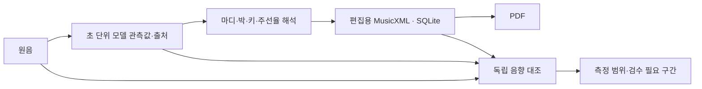

# 5곡 원음 대조와 채보 아키텍처 검토

What this repo does: 음원·YouTube·기존 악보를 편집용 MusicXML과 SQLite Song으로 만들고 사용자가 선택한 시점에 PDF/MIDI를 출력한다. 이번 검토는 로컬 사용자 1명, sidecar 1개, 무거운 모델 추론은 순차 실행하는 부하를 가정했다.

**판정: 실행 경로는 5/5 완료했지만 최소 수정 출판 품질은 승인하지 않는다. 모델 원본의 음높이 문제와 앱 변환기의 시간축 문제가 함께 발견됐다.** 전체 데스크톱/저장 구조를 폐기할 근거는 없으며, 모델 관측값·음악 해석·악보 직렬화·원음 검증 사이의 계약을 고쳐야 한다.

## 실제 실행과 근거

사용자 지정 정확한 다섯 버전의 준비된 원본 WAV를 실제 `/api/jobs` 업로드 → SheetSage2 CPU 추론 → SQLite Song → 명시적 PDF/MIDI/MusicXML export로 실행했다. 원본 음악·분리 stem·악보·가사·가중치는 공개하지 않는다. [전체 metadata-only 보고서](FIVE_SONG_SOURCE_REVIEW_2026-11-10.json)에 음원/모델/소스/출력 SHA와 단계별 결과를 보존한다.

- 모델: [공식 SheetSage2/MERT 고정 출처](SHEETSAGE2_VOCADITO_2026-11-10.md), CPU FP32/threads 4/default preset/300초 window. 실제 5곡 실행 source `ff777ceba6c8c74ddf74c84922355ab7c2285112`. 모델 선정·출시 승격이 아닌 진단 실행이다.
- 첫 시도는 환경 변수 엔진이 무시되어 5/5 HTTP 503, SheetSage2 추론 0건이었다. 원인 수정 후 실행 5/5 성공을 별도 시도로 기록한다.
- 파일 준비 이후 이번 배치에서 live YouTube 다운로드를 다시 실행하지 않았다. 가사와 사람 수정 시간도 평가하지 않았다.
- 변환 수정은 같은 원본 예측을 재사용했다. 모델 가중치를 다시 실행하거나 정답으로 음표를 고친 실험이 아니다. 원래 revision 1과 tempo 인쇄 수정 revision 2를 유지하고 박자/키 변환 수정본을 revision 3으로 저장·출력했다.
- 수정한 전체 pipeline도 같은 실제 모델 출력과 원음을 사용해 5/5 replay했다. 이 replay는 새 모델 추론이 아니며 별도 근거다. 음원 준비·pinned engine import·구조/코드 보고·악보 생성 경로를 확인했다.
- 후속 PDF 검토에서는 짧은 opening measure의 국소 재생 속도가 곡 전체 템포처럼 보이지 않도록, 모델 ABC의 nominal Q를 비재생 텍스트로 표시하고 정확한 동기화 tempo는 모두 숨긴다. 이 표시값도 모델 추정치이며 실제 BPM의 정답 승인이 아니다. MusicXML 재읽기에서 표시 숫자가 재생 tempo를 덮어쓰지 않으며, quarter-note 문자도 내장 폰트로 출력한다.

| 곡 | 실제 최초 추론→출력 | 원본 보컬 음표 | 모델 MIDI→악보 onset F1: 수정 전 → 후 |
| --- | ---: | ---: | ---: |
| Me So Bad | 93.47초 | 410 | 28.54% → 93.41% |
| FANCY | 100.89초 | 573 | 24.61% → 84.64% |
| American Idiot | 112.34초 | 354 | 32.20% → 95.48% |
| 나의 노래 | 154.69초 | 531 | 26.55% → 92.84% |
| 사건의 지평선 | 176.59초 | 573 | 53.75% → 94.42% |

위 F1은 프로젝트의 **음높이 일치·onset 50ms 변환 보존 지표**다. 원음 정답 대비 정확도가 아니다. 모델 원본에도 오류가 있으므로 값이 높아져도 원곡과 맞는다는 뜻이 아니다. 악보용 리듬 해석 때문에 raw 예측의 미세한 시간차도 바뀌며 무손실 변환으로 광고하지 않는다.

## 원음과의 독립 음향 대조

공식 [Demucs 4.0.1 htdemucs](https://github.com/facebookresearch/demucs)로 같은 다섯 원음을 CPU에서 보컬과 harmonic accompaniment(bass+other)로 분리했다. 공개 원본 checkpoint를 공식 filename hash prefix 검증 후 내려받고 전체 SHA를 기록했다. PyTorch의 `weights_only=True`를 유지하며 checkpoint에 필요한 알려진 class/Fraction/numpy 타입만 허용했다. shifts 0, overlap .25, seed 0, threads 4다. 입력은 기존에 고정한 mono WAV이므로 separator용으로 두 채널을 복제했으며 원본 stereo를 복원했다고 주장하지 않는다.

분리 보컬에 librosa 0.11 pYIN(11025Hz, hop 256, 55–880Hz)을 적용했다. 음표 안에서 voicing probability ≥ .9, 충분한 유효 프레임, 낮은 피치 변동을 만족한 안정 구간만 모델 음높이와 대조했다. 반주에는 CQT chroma와 삼화음 template 지지를 계산했다. 전체 원음과 모델을 다른 모델의 예측만으로 비교하지 않고 실제 파형 신호를 측정했지만, **분리·기본음·화음 추정치는 전문가 정답이 아니다.**

| 곡 | 안정 구간으로 대조한 예측 음표 | 옥타브 불일치 의심 | 그 외 음높이 불일치 의심 | 코드 지지 경고 / 대조 interval |
| --- | ---: | ---: | ---: | ---: |
| Me So Bad | 4 | 1 | 1 | 47 / 156 |
| FANCY | 4 | 4 | 0 | 18 / 138 |
| American Idiot | 2 | 1 | 1 | 13 / 89 |
| 나의 노래 | 20 | 11 | 9 | 15 / 170 |
| 사건의 지평선 | 38 | 31 | 7 | 15 / 148 |

**2,441개 중 68개 음표만 엄격한 안정 구간 조건을 만족했다. 이 제한된 표본의 비율을 전곡 음표 오류율로 환산하지 않는다.** 코드 경고는 모델 PC 집합보다 다른 삼화음의 스펙트럼 지지가 크게 강한 구간이다. 코드 오답 개수나 WCSR이 아니며, 확장음·전위·vocals bleed·약한 음량의 오판을 구분하려면 추가 검수가 필요하다. pYIN confidence도 정확도 확률로 보장하지 않는다.

구체적인 재검토 시각으로 Me So Bad 54.50–54.95초, FANCY 176.16–177.48초, American Idiot 46.11–46.61초, 나의 노래 77.30–77.78초, 사건의 지평선 120.22–122.53초에서 옥타브 불일치 근거를 확보했다. 원음/분리 보컬/모델 음표 재생 clip과 파형 기반 그래프, 모델 코드와 다른 삼화음 지지가 강한 시각은 **private local `review.html`**에 남겼다. 공개 문서에는 예측 악보나 음표 목록을 첨부하지 않는다.

## Must fix

1. **ABC 중간 박자·키 변경이 사라져 재생 시간이 누적 이동했다 — 이번에 수정.** (`src/audio_score_tool/sheetsage2_score.py`)
   - **What this is:** 공식 모델의 Vocal ABC와 playback map을 canonical MusicXML로 옮기는 어댑터다.
   - **Problem:** 기본 music21 ABC 분할은 단독 중간 `M:`/`K:`를 경계에서 누락한다. 가져오기 직후의 measure offset만 검사한 어댑터가 이를 놓쳤다. Me So Bad 원래 65.66초의 음표가 최종 악보 67.33초에 재생됐고 다른 곡도 몇 초씩 밀렸다. 이는 제가 추가한 어댑터의 검증 결함이며 모델 정확도와 별개다.
   - **Fix:** 실제 bar token만 경계로 분할해 metadata를 유지한다. 저장한 MusicXML을 다시 읽어 마디 수·시작·길이를 검사하고 실제 MIDI 출력도 대조한다. 3/4→1/4→3/4 및 G→C 회귀는 잘못 늘어난 박과 조표 누락을 검출한다.
   - **If we skip it:** 원래 모델이 맞힌 음표와 코드도 원음의 다른 시각에 놓인다. 5곡 revision 3 출력에는 수정이 반영됐다.

2. **재생용 tempo와 원음 BPM, 시작 후보와 실제 crop offset이 섞였다 — 이번에 수정.** (`pipeline_v2.py`, `music_structure.py`)
   - **What this is:** 채보 결과로 곡 구조 보고서를 만드는 단계다.
   - **Problem:** silent padding을 짧게 재생하기 위한 60,000,000 BPM MIDI 이벤트를 실제 추정 BPM으로 읽었다. 일부 일반 MIDI 경로는 적용되지 않은 170초짜리 시작 후보를 실제 원점으로 더할 수도 있었다.
   - **Fix:** SheetSage2는 공식 음원 beat/meter 관측값으로 구조를 보고하고 padding MIDI를 분석하지 않는다. 실제 trim이 수행된 경우에만 원점 offset을 더한다. median beat-derived BPM도 모델 추정치이며 실제 원곡 BPM 정확도 승인과 구분한다.
   - **If we skip it:** 정상적인 PDF 옆에 잘못된 분석값과 가사/검증 시각이 남고, 출력 성공이 분석 성공으로 오해된다.

3. **가사 시각이 첫 BPM에 고정됐다 — 이번에 수정.** (`lyrics.py`, `score_timing.py`)
   - **What this is:** ASR 초 단위 단어를 보컬 음표에 붙이는 정렬이다.
   - **Problem:** 120 BPM 한 마디 뒤 60 BPM으로 바뀌는 예제에서 실제 3.0초의 음표를 2.5초로 계산했다. SheetSage2의 마디별 tempo map에서는 오차가 더 누적될 수 있다.
   - **Fix:** 다른 코드/악보 정렬과 같은 score clock을 재사용한다. 120→60 BPM 회귀가 추가됐다.
   - **If we skip it:** 가사와 멜로디를 각각 맞혀도 음절이 다른 음표에 붙는다. 실제 5곡 가사는 이번 배치에서 검사하지 않았으므로 가사 품질 완료로 확대하지 않는다.

## Should fix

4. **기존 원음 validator는 옥타브를 구분하지 못한다 — 남음.** (`audio_symbol_validation.py`)
   - **What this is:** 원음과 악보 재합성의 음고류(chroma)를 비교하는 보조 검사다.
   - **Problem:** 220Hz와 440Hz 합성 음의 chroma cosine이 0.999971이었다. 이번 원음 대조에서 찾은 옥타브 문제를 이 검사만으로 잡을 수 없다. 혼합 원음과 보컬 중심 악보의 음고류 차이도 오답으로 단정할 수 없다.
   - **Fix:** 기본음/보컬 성부·음표 시점과 반주 화음을 각각 독립 측정하고, 측정 가능한 범위와 검수 필요 상태를 표시한다. 원음 근거가 없는 모델 간 합의나 LLM 판정을 정답으로 승격하지 않는다.
   - **If we skip it:** 기술적으로 정상인 악보의 큰 음역 오류가 검증에서 보이지 않는다. 이번 pYIN 연구 검사는 제품에 배선된 자동 verifier가 아니다.

5. **Job 정리 뒤 raw 모델 관측값을 재검토할 근거가 부족하다 — 남음.** (`song_store_v2.py`, `job_lifecycle_api_v2.py`)
   - **What this is:** 완료 Job을 버려도 Song의 악보와 원음은 보존하는 저장 계약이다.
   - **Problem:** Song에는 canonical MIDI/원음과 일부 chord/lyric JSON만 복사한다. SheetSage2의 raw Vocal MIDI·ABC·beat/key/playback·모델 SHA가 들어 있는 native Job workspace는 완료 Job 삭제 시 사라진다. 최종 악보 자체를 잃는다는 뜻은 아니다.
   - **Fix:** 원본 관측값과 source/model/runtime/clock provenance를 whitelist·크기 제한·SHA와 함께 Song 소유 자산으로 보존한다. 악보 수정 이력과 모델 원본을 구분하고 Job 삭제 후 재검증 회귀를 추가한다.
   - **If we skip it:** 나중에 발견한 문제가 모델 예측인지 악보 변환인지 재현하기 어렵다. 이번 연구용 private QA 원본은 별도로 보존했다.

6. **가장 음표가 많은 파트는 주선율이라는 보장이 없다 — 남음.** (`selected_stem_score.py:_main_part`)
   - **What this is:** 기존 MT3 계열에서 보컬 stem을 여러 MIDI 파트로 예측할 때 하나를 고르는 규칙이다.
   - **Problem:** 보컬 2음과 누출된 기타 10음을 가진 합성 예제에서 기타를 선택하고 이름만 Voice로 바꿨다. 선택 이후의 음표 보존 검사로 잘못된 성부 선택을 검출할 수 없다.
   - **Fix:** 성부 식별과 원음 기본음 일치로 주선율을 검증하거나 검증된 전용 melody provider를 사용한다. 단순한 이름 우선/음표 수 교체만으로 전체 문제를 해결했다고 하지 않는다.
   - **If we skip it:** 다른 AMT 모델을 고르더라도 잘못 고른 악기를 보컬 악보로 출력할 수 있다. 이번 5곡 SheetSage2 직접 Vocal 경로와 구분되는 문제다.

## 유지할 구조와 강화할 경계

SQLite/MusicXML 기반 편집, 원본과 revision 보존, 독립 renderer, 명시적 export는 유지한다. 필요한 보강은 새 웹/클라우드 계층이나 엔진 후보 수 확대가 아니라 다음 검증 경계다. 아래는 필요한 계약이며 모두 구현 완료됐다는 그림이 아니다.

검증: 수정 후 전체 Python 1,876 passed, 추가 원점 회귀 targeted 27 passed, 이전 Chromium 모델/YouTube 연결 6 passed. 실제 모델 출력 40개 변환 재검사에서는 39개 성공, 원래 보컬 예측이 빈 1개는 명확한 실패로 유지했다. 후속 전체 CI와 최신 커밋은 PR #205에서 추적한다.

Verdict: 전체 제품 구조를 버리지 말고 시간축·직렬화 경계를 먼저 고친 뒤, 독립 원음 검증과 raw 근거 보존을 갖춰야 한다. 현재 어느 모델도 이 결과만으로 목표 품질의 최종 기본 모델로 승인하지 않는다.

Not checked: 전문가 원곡 정답 대조, 전곡 note accuracy/chord WCSR, 가사 품질, 사람 수정량·시간, Windows에서 공식 SheetSage2 추론, 서명 배포·clean install, OMR/클라우드/결제·대규모 다중 사용자 구조. 지정한 다섯 곡은 사용자 인수·회귀 곡으로 유지한다. 이후 이 결과를 보고 모델/설정을 조정한 경우에는 이 다섯 곡의 수치를 독립 held-out 일반화 성능으로 주장하지 않는다.
