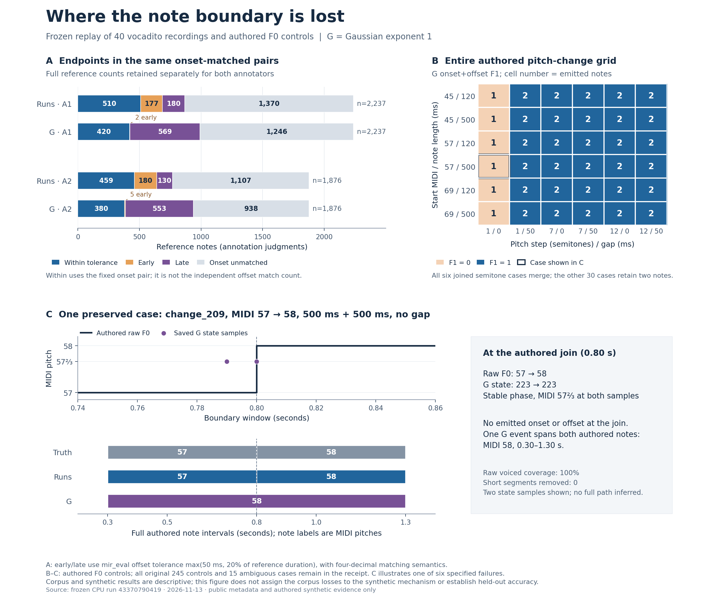

# Gaussian note-state 경계 진단 결과

- 날짜: 2026-11-13 (Asia/Seoul)
- 이슈: [#293](https://github.com/JDeun/audio-score-tool/issues/293)
- 구현·통합: [PR #295](https://github.com/JDeun/audio-score-tool/pull/295)
- [고정 프로토콜](NOTE_BOUNDARY_DIAGNOSTICS_PROTOCOL_2026-11-13.md), [선행 가정별 결과](NOTE_STATE_FACTORS_RESULTS_2026-11-13.md)
- 실행: [43370790419](https://github.com/JDeun/audio-score-tool/actions/runs/43370790419), job `131705792046`, attempt **1**, **success**
- Frozen head: `87a8bd7e3467c885e0fc6cfaf482e649b0f0f2c9`
- 실제 Actions checkout: `b76c5fa50fc157faaa48c7c0e9b4d7b5b8e12d54`
- 기준 main: `ddcbf4e6dc7df7c089c26efb3ef68bc156647978`
- 상태: 전체 재현·진단·독립 감사 완료. 새 모델 성능 조건과 제품 변경은 없다. Final-head 및 실제 main의 통합 검증은 #295에 기록한다.

## 결론

**Runs가 맞혔지만 Gaussian exponent 1(G)이 잃은 offset reference 730건은, G onset 미매칭 436건과 onset은 맞지만 늦게 끝난 294건으로 나뉜다.** 후자의 종료 지연 중앙값은 +90.929705ms이며, 허용 오차를 초과한 양의 중앙값은 36.281179ms다. 730건 전체를 늦은 종료나 병합이라는 한 원인으로 부르지 않는다.

G의 모든 onset 매칭 쌍 1,929건은 early 7 / within 800 / late 1,122다. 두 주석자 모두 같은 경향을 보이고, 모든 40×A1/A2 cell에서 종료 잔차 중앙값이 양수다. 내부 raw gap이나 짧은 구간 pruning과 겹치는 lost reference는 각각 4건과 2건으로 적다.

합성의 붙은 반음 여섯 개는 raw F0가 +1 semitone 바뀌는 바로 그 경계에서 **동일한 Stable pitch state**를 유지한다. 한 음이 경계를 가로지르고, 그 위치의 emitted onset/offset은 모두 0이다. 다음 [#296](https://github.com/JDeun/audio-score-tool/issues/296) / [사전 정의 프로토콜](NOTE_BOUNDARY_READOUT_PROTOCOL_2026-11-13.md)은 기존 G 경로를 유지하고 이미 고정된 raw-pitch hysteresis의 지속 변화점으로만 내부 구간을 추가 분할한다. 이 후속 변경은 아직 실행하지 않았다.

## 1. 이전 예측을 정확히 복원한 진단

이번 실행에서는 이전 `note_state_synthetic.py`, `run_note_state_factors.py`, private auditor를 수정하지 않고 다시 실행했다. 이전 raw 파일을 재사용한 것이 아니라, 새 실행에서 복원한 값의 identity를 보존된 원본 artifact와 비교했다.

| 재현 대상 | 결과 |
|---|---|
| 이전 scientific source | 24개 원본·현재 hash 일치 |
| 실제 녹음 | 40개 전체, A1/A2 80개 및 F0 reference 40개 identity 일치 |
| Corpus 예측 | 400개 전체 event hash·개수·모든 주석자 metric·gain/loss·diagnostics 정확히 일치 |
| Corpus 배열 | 440개 dtype·shape·raw-byte SHA256 identity 정확히 일치 |
| 합성 | 245개 spec·truth·대안 truth·eligibility 및 245개 input identity 일치 |
| 합성 예측/경로 | 1,715개 전체 prediction·score 및 1,470개 state path identity 일치 |
| 기존 집계 | 10개 corpus arm, 7개 synthetic arm, primary bootstrap, 역사적 parity, analytic emission 20행 일치 |
| 새 진단 source | 이전 24개를 포함한 35개 source identity 감사 통과 |

Corpus의 400개 예측을 모두 저장한 뒤 처음 reference를 읽었다. 합성도 1,715개 예측을 저장한 뒤 truth를 평가했다. 현재 NPZ container hash는 private 감사에서 확인했고, 과거와의 비교에는 내부 배열 identity를 사용했다. 실행 시간과 ZIP/NPZ container 생성 시각이 다른 것을 scientific identity 차이로 취급하지 않았다.

Runtime은 Python 3.11, NumPy 1.26.4, SciPy 1.13.1, librosa 0.10.2.post1, numba 0.60.0, soundfile 0.13.1, resampy 0.4.2, soxr 1.1.0, mir_eval 0.8.2, CPU 2 threads였다. 합성 replay 17.462601s, corpus replay 287.410461s, 새 진단 1.801461s, 새 private 감사 6.154100s였다. Corpus peak RSS는 718,468KiB다.

## 2. 기존 성능은 그대로다

새 진단을 성능 개선 실험으로 셈하지 않는다. 아래 값은 이전 예측의 정확한 재현이다. F1/precision/recall은 40개 녹음과 A1/A2 동일 가중 macro이고, matched count는 두 주석자의 판단 합계다.

| 방법 | Onset F1 | Onset+offset F1 | 실제 예측 음표 수 | Onset matched A1+A2 | Offset matched A1+A2 |
|---|---:|---:|---:|---:|---:|
| Pitch runs | 36.353202% | 22.149227% | 2,497 | 1,636 | 980 |
| 이전 HMM | 12.832055% | 3.528561% | 292 | 293 | 85 |
| G | 57.225361% | 24.270837% | 1,405 | 1,929 | 807 |

G의 runs 대비 onset은 38개 개선 / 2개 악화, offset은 20개 개선 / 20개 악화다. Offset macro precision은 20.702703%→28.949870%로 증가하지만 recall은 24.517944%→21.372789%로 감소한다. 예측수 감소와 실제 맞힌 reference의 감소를 함께 보아야 한다. 나머지 일곱 corpus 조건도 원본 `vocadito.json`에 그대로 보존되어 있으며 숫자가 바뀌지 않았다.

## 3. 동일 onset 매칭 쌍에서 측정한 종료 오차

각 방법의 onset-only 최대 matching을 고정하고, **그 동일한 쌍**에서 `prediction offset − reference offset`을 측정했다. Offset 허용 오차는 `max(50ms, reference duration×20%)`다. Mir_eval 0.8.2와 같이 절대 시간차를 소수점 네 자리로 반올림한 뒤 inclusive 비교했다. 연속 잔차와 tolerance excess는 반올림하지 않았다.

| 주석자 | 방법 | Onset 매칭 | Early | Within | Late | Onset 미매칭 | 전체 reference |
|---|---|---:|---:|---:|---:|---:|---:|
| A1 | Runs | 867 | 177 | 510 | 180 | 1,370 | 2,237 |
| A1 | G | 991 | 2 | 420 | 569 | 1,246 | 2,237 |
| A2 | Runs | 769 | 180 | 459 | 130 | 1,107 | 1,876 |
| A2 | G | 938 | 5 | 380 | 553 | 938 | 1,876 |
| A1+A2 | Runs | 1,636 | 357 | 969 | 310 | 2,477 | 4,113 |
| A1+A2 | G | 1,929 | 7 | 800 | 1,122 | 2,184 | 4,113 |

G의 onset 매칭 1,929건 중 late는 58.165%다. Onset 미매칭까지 포함한 전체 reference 4,113건을 분모로 한 그림도 아래에 제시한다. 같은 물리적 음표를 독립 표본 두 개로 세어 통계적 유의성을 주장하지 않는다.

| 같은 onset 쌍의 기술 통계 | Runs | G | 이전 HMM |
|---|---:|---:|---:|
| Signed offset Q25 | −39.019275ms | +43.129252ms | +124.195011ms |
| Signed offset median | +16.553288ms | +69.523810ms | +471.519274ms |
| Signed offset Q75 | +43.877551ms | +128.979592ms | +736.371882ms |
| Signed offset mean | −24.725581ms | +136.380898ms | +516.495709ms |
| Tolerance excess median | 0ms | 10.793650ms | 372.521542ms |
| Reference duration median | 214.784580ms | 255.419501ms | 464.399093ms |
| Prediction duration median | 180ms | 350ms | 950ms |

G의 cell별 중앙값은 A1 +44.546486..+178.775511ms, A2 +49.591836..+301.904762ms였다. 모든 80개 cell에서 양수이고 runs보다 크다. **그러나 방법별 onset 매칭 대상 집합이 다르므로, 이 중앙값 차이는 동일 reference에 대한 paired endpoint 이동량이 아니다.** 이를 일괄 offset 보정치로 사용하지 않는다.

### Fixed pair와 독립 offset matching의 차이

Fixed-pair within은 runs 969, G 800이며, 별도 offset maximum matching은 980, 807이다. 차이 11건과 7건은 offset matching이 고른 reference가 fixed onset matching에 없는 경우다. Fixed onset pair가 존재하는 reference에서 prediction을 다른 것으로 바꾼 경우는 두 방법 모두 0건이었다.

Onset compatibility graph에서 한 prediction에 reference 후보가 여러 개인 경우는 runs 16, G 19건이다. 한 reference에 onset prediction 후보가 여러 개인 경우는 0건이고, offset graph의 다중 후보도 0건이다. 후보 degree는 가능한 maximum matching 수나 유일성의 일반적 증명이 아니다.

G의 within 중 두 판단은 네 자리 반올림 때문에 raw excess가 극소 양수였으며 최대 0.045351ms였다. 이는 mir_eval 규칙을 그대로 반영한 결과이고, 294건의 lost-late 집합에는 포함되지 않는다.

## 4. Offset reference 손실 730건의 분해

각 주석자의 reference ID 기준으로 G와 runs의 offset-matched 집합을 나눴다. 네 집합은 전체 reference를 빠짐없이 분할한다.

| 분류 | A1 | A2 | 합계 | G onset 미매칭 | G onset 매칭: early / within / late |
|---|---:|---:|---:|---:|---|
| Retained: 둘 다 offset 매칭 | 134 | 116 | 250 | 4 | 0 / 246 / 0 |
| Gained: G만 offset 매칭 | 293 | 264 | 557 | 3 | 0 / 554 / 0 |
| Lost: runs만 offset 매칭 | 387 | 343 | 730 | 436 | 0 / 0 / 294 |
| Neither: 둘 다 offset 미매칭 | 1,423 | 1,153 | 2,576 | 1,741 | 7 / 0 / 828 |
| 전체 | 2,237 | 1,876 | 4,113 | 2,184 | 7 / 800 / 1,122 |

Lost 730건의 **59.726%는 G onset 미매칭**, **40.274%는 onset 매칭 후 late**다. Retained/gained의 onset 미매칭 7건은 위 독립 matching의 reference 선택 차이다. Onset 미매칭을 곧바로 “물리적 onset이 없었다” 또는 “합쳐진 음”이라고 해석하지 않는다. Pitch/onset tolerance와 matching 선택이 모두 영향을 준다.

| Lost 중 G onset이 맞은 쌍 | A1 | A2 | 합계 원표본 |
|---|---:|---:|---:|
| 쌍 수 | 148 | 146 | 294 |
| Early / within / late | 0 / 0 / 148 | 0 / 0 / 146 | 0 / 0 / 294 |
| Signed offset median | +86.235828ms | +94.875284ms | +90.929705ms |
| Tolerance excess median | 32.335601ms | 40.804989ms | 36.281179ms |

합계 중앙값은 A1/A2 중앙값의 평균이 아니라 원래 294개 pair에서 계산했다. 40개 모든 녹음과 두 주석자에서 lost reference가 발생한다. G onset 매칭이 남아 late를 측정할 수 있는 lost 사례는 A1 36개 녹음, A2 37개 녹음에 존재하며 나머지 해당 cell의 손실은 모두 onset 미매칭이었다.

## 5. 겹침, 무성 관측, pruning의 범위

시간 overlap은 교집합 길이가 엄격히 양수인 경우다. 끝점만 닿는 것은 제외하고 pitch 조건은 두지 않는다. 아주 작은 endpoint 오차도 다중 overlap을 만들 수 있으므로 실제 merge/split이라고 라벨링하지 않는다.

이를 보완해 prediction `[onset, offset)` 안에 reference onset이 두 개 이상 들어가는 경우를 별도로 집계했다.

| 주석자 | 방법 | 실제 prediction 수 | 여러 reference onset을 포함한 prediction | 해당 prediction 안에 onset이 있는 reference |
|---|---|---:|---:|---:|
| A1 | Runs | 2,497 | 97 | 204 |
| A1 | G | 1,405 | 449 | 1,182 |
| A2 | Runs | 2,497 | 61 | 132 |
| A2 | G | 1,405 | 323 | 818 |

모든 80개 cell에서 마지막 열의 G 수가 runs보다 많다. G가 더 적은 긴 event로 여러 reference onset을 포함하는 양상과 일치하지만, 각 사례의 음악적 원인이나 올바른 경계를 확정한 것은 아니다.

Lost 730건에서:

- G prediction과 양의 시간 overlap이 전혀 없는 reference는 **0건**이다. 올바른 pitch나 전체 구간 지원을 뜻하지 않는다.
- 다중 reference와 겹치는 G prediction에 overlap을 가진 reference는 **573건**이다.
- 여러 reference onset을 포함하는 G prediction 안에 자기 onset이 있는 reference는 **395건(54.110%)**이다. 이 집합과 onset 미매칭 436건의 교차표는 공개 summary에 없으므로 동일시하지 않는다.
- Raw unvoiced 프레임을 하나라도 포함한 reference는 **93건**, 합계 **136프레임**이다. 그중 window 내부에서 양쪽 유성으로 둘러싸인 gap은 **4개 reference의 4개 run(0.548%)**이다.
- Raw voiced인데 G가 Silent인 관측은 **47개 reference의 48프레임**이다.
- Raw unvoiced인데 G가 voiced인 관측은 **0프레임**이다.
- G의 최소 길이 pruning 구간과 양의 overlap을 가진 reference는 **2건(0.274%)**, 겹친 시간 합은 **0.034535147s**다.

이 비율은 reference window 안의 기술 통계다. A1/A2와 겹치는 reference는 같은 관측을 중복 셀 수 있다. 인과적 부재 증명은 아니지만, 이번 lost 집합 대부분을 내부 raw gap이나 마지막 80ms 필터로 설명할 근거는 부족하다.

Corpus 전체의 기존 readout 진단도 보존됐다. G의 raw voiced→Silent는 1,200/64,502프레임(1.860407%), prefilter 1,418→최종 1,405개, short-pruning 13개/0.39s다. Decoded voiced가 raw-zero인 두 프레임은 이미 버려진 짧은 구간에 있어 최종 emitted bridging은 0이다. Runs/G/이전 HMM을 포함한 10개 arm의 실제 녹음 빈 출력은 모두 0이다.

## 6. 붙은 반음 여섯 개: 관측 경계가 상태 표현에 없음

모든 245개 authored control과 7개 arm의 출력·점수·경로 identity가 이전과 같았다. G는 accuracy-eligible 227개 중 221개를 완전히 맞혔고, 남은 여섯 개는 다음과 같다.

| 시작 MIDI | 각 음 길이 | Case | 경계 frame | G state 전후 | G pitch-bin → MIDI | 경계의 emitted onset / offset |
|---:|---:|---|---:|---|---|---|
| 45 | 120ms | `change_195` | 42 | 115 → 115, Stable | 38 → 45⅔ | 0 / 0 |
| 45 | 500ms | `change_197` | 80 | 115 → 115, Stable | 38 → 45⅔ | 0 / 0 |
| 57 | 120ms | `change_207` | 42 | 223 → 223, Stable | 74 → 57⅔ | 0 / 0 |
| 57 | 500ms | `change_209` | 80 | 223 → 223, Stable | 74 → 57⅔ | 0 / 0 |
| 69 | 120ms | `change_219` | 42 | 331 → 331, Stable | 110 → 69⅔ | 0 / 0 |
| 69 | 500ms | `change_221` | 80 | 331 → 331, Stable | 110 → 69⅔ | 0 / 0 |

여섯 개 모두 gap 0, raw F0 step +1 semitone, voiced coverage 100%, pruning 0, 경계를 가로지르는 최종 event 한 개다. 정확한 raw 변화점에서 state와 decoded label이 바뀌지 않는다. 가장 가까운 decoded-label 변화까지의 거리는 −12프레임 또는 −50프레임이며 이는 바깥 구간 경계다. 동거리이면 앞선 변화를 고르는 고정 정책을 사용했다.

`change_209`는 raw MIDI 57이 0.30–0.80s, 58이 0.80–1.30s다. 경계 직전/직후 0.79/0.80s에 저장된 G state는 둘 다 223, MIDI 57⅔의 Stable이다. 최종 음표는 raw median 57.5를 기존 `rint` 규칙으로 처리한 MIDI 58의 0.30–1.30s 한 개다. 전체 state path를 공개 샘플 두 점에서 임의로 복원한 것이 아니다.

36개 pitch-change 전체를 보면 gap 50ms의 +1 조건 여섯 개와 +7/+12의 24개는 모두 두 음을 유지하고 기존 F1 1이다. +7/+12의 gap 0에서는 G topology의 Silent 프레임 때문에 exact join의 emitted offset/onset이 같은 위치에 있지 않을 수 있지만, 이전 50ms tolerance의 점수는 모두 1이다. Exact-frame boundary descriptor를 새로운 F1이라고 부르지 않는다.

단음 140개, gap>0 동음 반복 45개, vibrato/drift 6개도 G의 기존 성공을 유지한다. 나머지 동음 gap 0 아홉 개와 dropout 여섯 개는 같은 관측에 다른 truth 해석이 가능한 조건으로 남고, silence 세 개는 별도 false-positive 대조다. 모호성 15개를 합성 실패 여섯 개와 섞지 않는다.

그림 A는 전체 reference를 분모로 두고 A1/A2를 분리했다. Within은 fixed onset pair의 판정이며 독립 offset matching 수가 아니다. B는 전체 36개 pitch-change 격자다. C는 이전 보고서에서도 사용한 `change_209`와 공개된 두 state 관측을 보여 준다. 실제 corpus 손실 전체를 이 한 합성 기전으로 설명하지 않는다. [SVG 원본](figures/note-boundary-diagnostics-2026-11-13.svg).

## 7. 모든 40개 녹음의 결과

Onset/offset F1은 각 녹음의 A1/A2 평균이다. Loss 분해는 두 주석자의 reference 판단 합계다. G 중앙값은 해당 녹음·주석자의 fixed onset pair이며, 서로 다른 방법/녹음의 matched population을 동일 표본이라고 가정하지 않는다. 표시는 반올림했으며 원본 값은 receipt에 있다.

| 녹음 | 예측 수 runs→G | Onset F1 runs→G | Offset F1 runs→G | Offset Δ pp | Lost: onset 미매칭 / late | G 잔차 median A1 / A2 (ms) |
|---|---:|---:|---:|---:|---:|---:|
| vocadito_1 | 75→51 | 48.287%→68.458% | 35.069%→27.589% | -7.480 | 15 / 16 | +72.449 / +72.653 |
| vocadito_2 | 77→34 | 31.993%→47.470% | 21.765%→27.038% | +5.274 | 21 / 2 | +57.937 / +59.252 |
| vocadito_3 | 48→39 | 49.667%→69.608% | 37.277%→36.340% | -0.937 | 9 / 11 | +55.737 / +64.728 |
| vocadito_4 | 55→35 | 27.054%→47.697% | 20.055%→19.879% | -0.176 | 13 / 5 | +82.290 / +109.467 |
| vocadito_5 | 87→42 | 43.871%→33.448% | 26.157%→14.111% | -12.046 | 34 / 5 | +104.467 / +87.528 |
| vocadito_6 | 73→32 | 41.603%→47.782% | 17.892%→13.298% | -4.593 | 18 / 3 | +109.762 / +79.116 |
| vocadito_7 | 57→37 | 40.443%→71.007% | 22.650%→40.115% | +17.465 | 4 / 8 | +46.236 / +66.837 |
| vocadito_8 | 43→30 | 69.940%→77.377% | 42.982%→21.940% | -21.042 | 14 / 14 | +70.204 / +63.458 |
| vocadito_9 | 63→41 | 37.252%→59.126% | 21.056%→28.592% | +7.536 | 12 / 3 | +55.930 / +54.569 |
| vocadito_10 | 36→17 | 23.787%→49.650% | 14.979%→10.315% | -4.664 | 7 / 3 | +137.188 / +85.283 |
| vocadito_11 | 38→19 | 30.706%→51.531% | 22.431%→13.520% | -8.911 | 5 / 8 | +178.776 / +75.896 |
| vocadito_12 | 40→21 | 32.043%→68.611% | 19.823%→34.306% | +14.483 | 3 / 0 | +73.753 / +73.753 |
| vocadito_13 | 78→34 | 24.261%→47.804% | 15.698%→17.399% | +1.700 | 13 / 7 | +72.404 / +74.478 |
| vocadito_14 | 49→22 | 35.277%→63.690% | 11.357%→34.821% | +23.464 | 5 / 4 | +69.002 / +63.027 |
| vocadito_15 | 48→37 | 26.044%→36.996% | 11.934%→19.689% | +7.755 | 7 / 0 | +53.560 / +54.376 |
| vocadito_16 | 58→36 | 34.053%→68.641% | 21.003%→31.124% | +10.121 | 5 / 9 | +72.721 / +72.483 |
| vocadito_17 | 65→31 | 16.387%→34.314% | 11.239%→17.104% | +5.865 | 10 / 1 | +123.061 / +301.905 |
| vocadito_18 | 82→47 | 25.305%→64.707% | 21.294%→40.700% | +19.407 | 4 / 5 | +65.023 / +52.313 |
| vocadito_19 | 104→54 | 35.131%→67.936% | 16.394%→27.299% | +10.904 | 7 / 20 | +64.535 / +64.535 |
| vocadito_20 | 31→23 | 42.279%→65.409% | 30.910%→22.432% | -8.478 | 9 / 6 | +66.542 / +69.297 |
| vocadito_21 | 89→41 | 34.672%→46.503% | 19.323%→21.071% | +1.748 | 20 / 6 | +90.930 / +57.914 |
| vocadito_22 | 45→34 | 44.010%→58.744% | 25.266%→17.534% | -7.732 | 10 / 10 | +71.361 / +88.662 |
| vocadito_23 | 58→39 | 30.011%→64.807% | 13.629%→27.488% | +13.859 | 5 / 6 | +84.989 / +78.073 |
| vocadito_24 | 43→25 | 36.251%→70.994% | 16.756%→27.045% | +10.290 | 7 / 4 | +82.041 / +88.209 |
| vocadito_25 | 48→28 | 27.534%→74.069% | 23.902%→42.399% | +18.498 | 3 / 4 | +49.195 / +60.794 |
| vocadito_26 | 47→38 | 44.830%→52.310% | 34.976%→23.002% | -11.974 | 24 / 10 | +62.268 / +49.592 |
| vocadito_27 | 38→24 | 47.854%→69.297% | 31.944%→27.653% | -4.292 | 3 / 9 | +87.370 / +80.272 |
| vocadito_28 | 46→30 | 35.768%→58.497% | 16.742%→19.030% | +2.288 | 10 / 5 | +66.723 / +71.519 |
| vocadito_29 | 47→25 | 45.676%→69.629% | 29.648%→29.019% | -0.628 | 5 / 11 | +60.816 / +59.229 |
| vocadito_30 | 41→30 | 38.721%→37.045% | 25.926%→4.838% | -21.088 | 14 / 7 | +80.227 / +96.395 |
| vocadito_31 | 45→30 | 54.885%→58.155% | 43.426%→22.154% | -21.272 | 12 / 16 | +81.451 / +82.902 |
| vocadito_32 | 81→32 | 29.923%→52.305% | 17.498%→11.339% | -6.159 | 10 / 13 | +102.200 / +136.111 |
| vocadito_33 | 108→55 | 35.445%→53.427% | 15.595%→11.633% | -3.962 | 14 / 12 | +69.875 / +105.023 |
| vocadito_34 | 76→49 | 29.250%→41.184% | 16.715%→17.844% | +1.130 | 12 / 4 | +51.939 / +108.186 |
| vocadito_35 | 45→32 | 33.408%→61.744% | 20.268%→40.980% | +20.712 | 7 / 3 | +56.349 / +60.249 |
| vocadito_36 | 82→49 | 36.439%→52.184% | 22.439%→20.162% | -2.276 | 14 / 11 | +64.172 / +63.073 |
| vocadito_37 | 90→39 | 28.526%→54.444% | 15.327%→43.750% | +28.423 | 12 / 2 | +58.810 / +61.463 |
| vocadito_38 | 88→54 | 37.207%→65.716% | 17.153%→11.903% | -5.250 | 6 / 20 | +79.603 / +74.376 |
| vocadito_39 | 115→39 | 35.968%→42.515% | 20.226%→17.346% | -2.879 | 26 / 9 | +72.517 / +69.524 |
| vocadito_40 | 58→30 | 32.369%→64.182% | 17.249%→37.030% | +19.782 | 7 / 2 | +44.546 / +103.016 |

## 8. 독립 감사와 원본 보존

| 검증 | 결과 | 실제 확인한 범위 |
|---|---:|---|
| 기존 private replay 감사 | 42,867 checks | 400개 note·440개 배열, 원본 WAV/reference/F0, readout/RMS, 직접 점수, 역사적 baseline |
| 새 private 경계 감사 | 208,855 checks | 새 코드와 독립적인 matching/residual/overlap/support/합성 경계, 35개 source, 이전 전체 payload 재현 |
| 다운로드 후 공개 artifact 감사 | 209,349 checks | 원 ZIP/member/source hash, 전체 재현 payload, per-case/annotator 산술, owned F0/event/점수와 공개 boundary 일관성 |

새 private 감사와 다운로드 후 감사의 최대 수치 차이는 모두 **2.220446049250313e−16**이다. 이전 private 감사의 최대 차이는 3.552713678800501e−15였다. 감사 통과는 새로운 학습 데이터나 독립 사람 정답, 제품 품질 승인을 의미하지 않는다.

새 private auditor는 새 runner/diagnostic/model/scorer를 import하지 않는다. 변경하지 않은 파싱·배열·readout helper만 이전 auditor에서 재사용하고 새 통계는 별도 계산한다. WAV와 원래 human F0 파일의 두 번째 재독출은 기존 private audit binding에 의존하며, note·note reference·배열은 직접 다시 읽는다.

다운로드 후 감사는 authored F0 245개 hash를 NumPy 1.26.4로 재구성하고, canonical synthetic event 1,715개 hash 및 eligible 227×7=1,589개 직접 score pair를 확인했다. **실제 corpus의 개별 종료 오차, pooled quartile, full synthetic path는 공개 자료만으로 재계산하지 않았다.** Pooled quartile은 범위/순서만 확인했고, 원표본 계산은 Actions private 감사가 담당한다. 이 구분은 별도 receipt에도 기록했다.

원본 artifact `14012856593`의 [ZIP](receipts/note-boundary-diagnostics-43370790419.zip)은 **631,149 bytes**, SHA256 **`43b439e665eb470ec1b24179697cc99d2733fecb6122d1da6a77125d8e3ccf31`**이며 재압축하지 않았다.

| 원본 ZIP member | Bytes | SHA256 |
|---|---:|---|
| `synthetic.json` | 2,847,165 | `951126423569badb3ae621811d7330474c6aeb6fd4593f312cd4e0e21d736993` |
| `vocadito.json` | 1,625,622 | `e086eaefad71892a679f3d49668dc4ef9eb791def0ad16c52ee49731d813e9eb` |
| `replay-audit.json` | 282,759 | `777cdfe6850d402bfb70d9351e3a9ae400c585a4a3a5e210c43914b9e4c1fc1c` |
| `diagnostics.json` | 8,483,795 | `7082307ceeceb12d096bf5e41692ac7e1dcfca7f3a8580be8580fdd638c671df` |
| `audit.json` | 765,544 | `524477e7548b21a942f13a8b38723d914d27cd90f646df00ec75e2ca5c9295cc` |

별도 [postrun receipt](receipts/note-boundary-postrun-audit-43370790419.json)는 9,145 bytes, SHA256 `02e5f32a52118fda64f0bc937c8d73d6d4908684dba82e4e5f41f09b1a921c86`이다. 실제 WAV·reference 본문·개별 actual note 시간·full F0/path는 공개하지 않았다. Corpus residual 분포와 counts, owned synthetic truth/event/boundary만 공개했다.

## 9. 검증 및 다음 결정

실행 전 로컬과 고정 CPU workflow에서 이전·신규 11개 test file **384개**가 통과했다. 신규 129개에는 matching 반올림, 같은 pair, ambiguous assignment, 붙은 끝점, onset containment, raw gap/pruning, exact identity, 누락·변조·부분 반환의 실패 처리가 포함된다. Ruff와 forensic hygiene, wiki, 연구 ledger shape 검증도 통과했다.

Frozen-head [CI 43370790339](https://github.com/JDeun/audio-score-tool/actions/runs/43370790339)는 product **2,119 passed / 9 optional skips**, research **2,020 passed / 1 existing warning**, frontend **69 passed**, required verify success였다. Test partition은 product 200 / research 70 files, 누락 0이다. [Evidence Contracts 43370791390](https://github.com/JDeun/audio-score-tool/actions/runs/43370791390)는 34개를 통과했다. Final-head 및 병합된 실제 main의 검증은 #295의 완료 기록을 따른다.

후속 [#296](https://github.com/JDeun/audio-score-tool/issues/296)은 기존 G 내부에서 **지속 raw-pitch 변화점의 추가 분할만** 시험한다. 5프레임은 이전 구현의 값으로 고정하고, 69ms/91ms에 맞춘 일괄 offset 이동은 넣지 않는다. 기존 G 경계·경로·voicing을 유지하고 자식 구간에 같은 median pitch와 80ms 필터를 적용한다. 추가 cut과 짧은 자식 삭제, 기존 정답 손상을 모두 평가한다. [후속 프로토콜](NOTE_BOUNDARY_READOUT_PROTOCOL_2026-11-13.md)은 이 정의와 전체 대조, prediction barrier를 실행 전에 명시한다.

이번 40개 녹음과 합성 격자는 반복 사용한 개발 증거다. 더 정확한 경계 원인을 좁혔지만 새 readout의 개선, 미사용 데이터 일반화, 사용자 편집 비용 감소, Melodyne/Flex Pitch의 오디오 편집 품질, polyphonic 처리나 [#281](https://github.com/JDeun/audio-score-tool/issues/281)의 같은 악보 복원을 검증한 것은 아니다. 제품 기본값·의존성·자동 보정은 변경하지 않았다. 별도 #236에는 변경을 가하지 않았다. 작업 중 독립적인 #294의 결과 문서 네 개가 main `f29944d8e8be32a1f274472ac68ec52f1c1cbc8e`에 병합됐으며, 이번 frozen scientific 파일과 겹치는 변경은 없다. 해당 문서도 최종 통합에서 보존한다.
