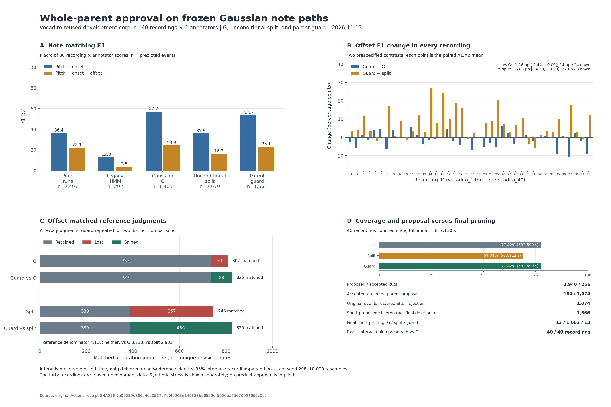
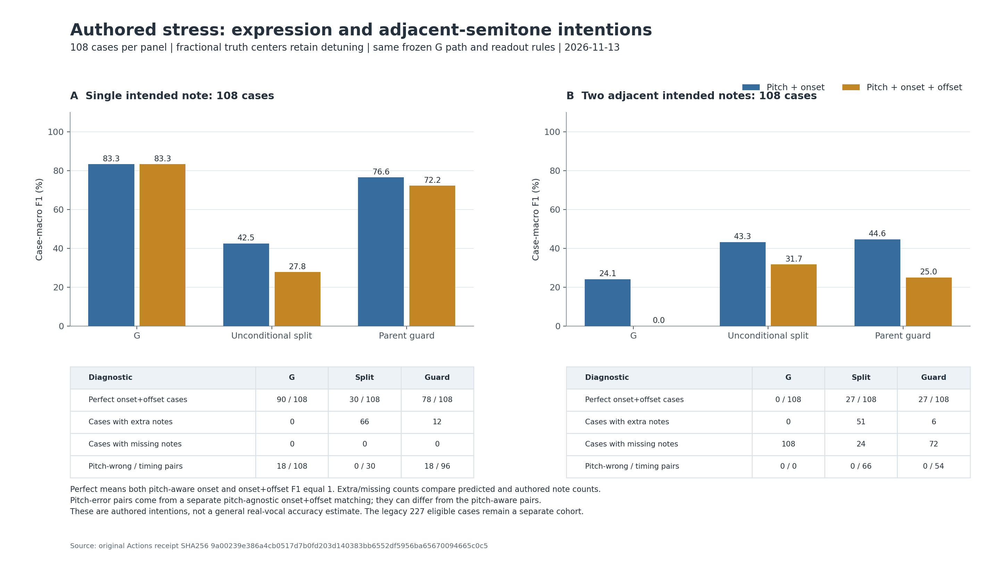

# 부모 음을 보존하는 분할 승인 규칙의 결과

- 날짜: 2026-11-13 (UTC)
- 이슈/PR: [#298](https://github.com/JDeun/audio-score-tool/issues/298) / [#301](https://github.com/JDeun/audio-score-tool/pull/301)
- 사전 정의: [설계 프로토콜](NOTE_BOUNDARY_PARENT_GUARD_PROTOCOL_2026-11-13.md), [실행 명세](NOTE_BOUNDARY_PARENT_GUARD_EXECUTION_2026-11-13.md)
- 실험: [run 43389159299, attempt 1](https://github.com/JDeun/audio-score-tool/actions/runs/43389159299), [job 131764674264](https://github.com/JDeun/audio-score-tool/actions/runs/43389159299/job/131764674264)
- Frozen head: `950756cae05fad902548112fef99de85f6ff3b65`; frozen tree: `f29eb9967e85fa8ec12d819950cbdb4328b0bdff`
- 실제 PR checkout: `5c63786a10dfd0422fb9fbbe7abfdea81862d876`
- 상태: **전체 실행·세 private 독립 감사·공개 원본 후검증 완료. 출력 구간 보존은 성공했지만 사전 정확도 조건을 통과하지 못했으므로 후보를 채택하지 않는다.** 코드 통합의 최종 head·병합·실제 main 검증은 PR #301에 별도로 기록한다.

## 판단

Parent guard는 [이전 무조건 분할 실험](NOTE_BOUNDARY_READOUT_RESULTS_2026-11-13.md)의 출력 시간 손실을 제거했다. 기준 G가 출력하던 **632.590250초의 구간 합집합을 실제 녹음 40/40개에서 정확히 보존**했고, 짧아서 최종 삭제되는 구간도 G와 같은 13개로 유지했다. 무조건 분할보다 offset-inclusive F1은 **16.279944%→23.113588%**로 높아졌다.

그러나 주 기준선 G의 **24.270837%**에는 못 미쳤다. Guard−G offset F1은 **−1.157250 percentage points(pp)**, 사전 고정한 recording-paired 95% bootstrap 구간은 **[−2.437908, +0.085429]pp**다. 40개 중 14개 개선, 24개 악화, 2개 동일했다. Onset F1도 **57.225361%→53.469785%**, **−3.755575pp**로 낮아졌다. 사전 최소 조건인 **G 대비 offset 증가와 onset 비감소가 모두 실패**했다. Offset 구간이 0을 포함한다는 사실은 동등성이나 안전성의 입증이 아니다.

기존 합성의 붙은 반음 6/6개를 회복하고 G의 이전 성공 221/221개를 보존했다. 하지만 새 단일음 표현 스트레스에서는 guard가 G에 없던 과분할 12/108개를 만들었고, 인접 반음 스트레스에서는 72/108개가 여전히 한 음으로 병합됐다. **80ms를 통과하는 자식만 허용하는 규칙은 출력 시간 보존 조건으로는 작동하지만, 의도된 음표 경계를 구분하는 충분조건은 아니었다.**

제품 기본값·자동 보정·모델 의존성은 변경하지 않는다. G는 후속 연구의 기준선으로 남으며, 이 결과로 G 자체의 제품 품질을 승인하지도 않는다. [#281](https://github.com/JDeun/audio-score-tool/issues/281)의 공통 평가·reference 의미 정렬은 계속 우선 과제다. 제품 완성도와 배포 수용 조건은 [#36](https://github.com/JDeun/audio-score-tool/issues/36), [#299](https://github.com/JDeun/audio-score-tool/issues/299), [#300](https://github.com/JDeun/audio-score-tool/issues/300)에서 따로 관리한다.



[SVG](figures/note-boundary-parent-guard-2026-11-13.svg). 그림은 원본 ZIP의 공개 metadata를 읽어 만든다. A1+A2의 matching 판단 수는 고유 물리적 음표 수가 아니며, panel C의 두 비교는 각각 G와 split을 기준으로 한 별도 집합이다.

## 고정한 것과 바꾼 한 가지

기준선은 `gaussian_exponent_1`(G), 이전 방법은 `gaussian_raw_hysteresis_split`(split), 새 arm은 `gaussian_raw_hysteresis_parent_guard`(guard)다. 같은 pYIN 관측과 G state path를 공유한다. 새 HMM을 독립적으로 decode하지 않는다. 원래 raw Hz 전체에 기존 5-frame hysteresis를 적용하고, 양성 pitch label 사이의 지속 변화점 중 부모 안쪽에 있는 위치를 후보 cut으로 삼는 규칙도 같다.

이번 변경은 **원래 G가 실제로 출력한 부모에서만 분할을 제안하고, 모든 자식이 기존 readout을 통과할 때만 부모 전체의 분할을 승인하는 것**이다. 자식 중 하나라도 positive raw support, 양의 길이, audio 끝 clipping 이후 80ms 조건을 만족하지 못하면 원래 G `Note`를 그대로 복구한다. Cut이 없는 부모 역시 원래 객체를 재사용한다. G에서 이미 제외된 부모를 다시 출력하지 않는다. 승인한 자식들의 구간 합집합은 원래 부모와 같아야 한다.

각 자식의 pitch는 기존 raw-positive MIDI median→`rint`다. Hysteresis label을 출력 pitch로 대체하지 않았다. Emission/transition, frontend, pitch grid, Viterbi tie, 80ms, timestamp, scorer tolerance를 탐색하지 않았다. 실험 결과를 보고 cut 선택이나 guard 규칙을 다시 조정하지 않았다.

실제 vocadito **40개×12 arms=480개 prediction**을 모두 저장한 다음 첫 human reference를 읽었다. 두 주석자를 모두 평가해 **960개 annotation score row**를 얻었다. 합성은 기존 245개와 새로운 두 108개 코호트, 합계 **461개×9 arms=4,149개 prediction**을 모두 저장한 다음 truth를 평가했다. 평가 전후 prediction manifest는 동일하다. 완료되지 않은 case나 빈 guard corpus output은 없다.

실험 source는 [66개 frozen inventory](NOTE_BOUNDARY_PARENT_GUARD_FROZEN_SOURCES_2026-11-13.json)로 묶었다. 이전 #297의 53개 source는 그대로다. 이 결과 문서·그림·그림 helper·다운로드 후 공개 감사 helper와 source-map 사본은 실행 후 산출물이며 frozen 66개에 소급 편입하지 않는다.

## 실제 녹음: 두 비교를 구분한 성능

Pitch 50 cents, onset 50ms, offset `max(50ms, 20% reference duration)` 조건이다. 이 문서의 onset F1에도 pitch 조건이 포함된다. Reference Hz와 파일별 8자리 F1을 그대로 유지한다. F1·precision·recall은 40개 녹음×A1/A2의 80개 cell을 동일 가중한 macro다. 출력 음 수는 주석자를 중복하지 않고 40개 녹음을 한 번씩 센다.

| Arm | 출력 음 수 | Onset F1 % | Onset P % | Onset R % | Offset F1 % | Offset P % | Offset R % |
| --- | --- | --- | --- | --- | --- | --- | --- |
| Runs | 2497 | 36.353202 | 33.789840 | 40.481840 | 22.149227 | 20.702703 | 24.517944 |
| 기존 HMM | 292 | 12.832055 | 49.119307 | 7.607332 | 3.528561 | 10.767992 | 2.180670 |
| G | 1405 | 57.225361 | 69.333510 | 49.729823 | 24.270837 | 28.949870 | 21.372789 |
| Split | 2679 | 35.916666 | 32.268960 | 41.564624 | 16.279944 | 14.629904 | 18.850001 |
| Guard | 1661 | 53.469785 | 59.503460 | 49.611859 | 23.113588 | 25.410947 | 21.726281 |

| 비교 | Offset Δ pp | Paired 95% CI pp | Offset 개선/악화/동일 | Onset Δ pp | Onset 개선/악화/동일 |
|---|---:|---|---|---:|---|
| **주 대비: guard−G** | **−1.157250** | **[−2.437908, +0.085429]** | **14 / 24 / 2** | **−3.755575** | **9 / 29 / 2** |
| 보조 대비: guard−split | +6.833643 | [+4.532784, +9.291621] | 32 / 8 / 0 | +17.553120 | 39 / 1 / 0 |

각 recording의 A1/A2 평균 차이를 한 단위로 삼아 `default_rng(298)`, 10,000회 `(10000,40)` index 재표집과 linear 2.5/97.5 percentile을 사용했다. 두 대비에 같은 사전 규칙을 적용했다. 이 구간은 반복 사용한 개발 녹음 40개에서의 기술적 불확실성이며, 미사용 자료의 일반화 구간이 아니다.

Guard는 G보다 256개 많은 음을 출력한다. Onset precision은 69.333510%→59.503460%, recall은 49.729823%→49.611859%다. Offset precision은 28.949870%→25.410947%, recall은 21.372789%→21.726281%다. 일부 offset recall 회복과 전체 F1 하락이 함께 나타난다. 보조 대비가 좋아졌다는 사실로 주 대비 실패를 대체하지 않는다.

### 실제 matched-reference 집합

분모는 **A1 2,237개+A2 1,876개=4,113개 annotation judgment**다. 두 주석자가 같은 실제 음에 관해 각각 판단할 수 있으므로 고유 물리적 음표 4,113개가 아니다. 유지(retained), 획득(gained), 손실(lost), 양쪽 모두 실패(neither)는 각 기준선과 guard의 실제 reference ID matching 집합을 비교한다.

| Guard의 비교 기준 | 지표 | 유지 | 획득 | 손실 | 양쪽 실패 | 기준선 matched | Guard matched |
| --- | --- | --- | --- | --- | --- | --- | --- |
| G | onset | 1811 | 126 | 118 | 2058 | 1929 | 1937 |
| G | offset | 737 | 88 | 70 | 3218 | 807 | 825 |
| Split | onset | 1141 | 796 | 537 | 1639 | 1678 | 1937 |
| Split | offset | 389 | 436 | 357 | 2931 | 746 | 825 |

G→guard는 onset matched 1,929→1,937건, offset matched 807→825건이다. 순증가가 각각 8건·18건이어도 macro F1은 낮아진다. 예측 수 증가와 녹음별·주석자별 가중을 함께 반영하기 때문이다. Pooled matched count를 사전 지정한 macro F1 대신 사용하지 않는다. Split→guard는 onset 1,678→1,937건, offset 746→825건이다.

### A1/A2별 결과

| 주석자 | G onset % | Split onset % | Guard onset % | Guard−G onset pp | G offset % | Split offset % | Guard offset % | Guard−G offset pp |
| --- | --- | --- | --- | --- | --- | --- | --- | --- |
| A1 | 56.012559 | 37.546366 | 53.282478 | -2.730081 | 24.257788 | 17.083221 | 23.537768 | -0.720020 |
| A2 | 58.438162 | 34.286965 | 53.657093 | -4.781069 | 24.283887 | 15.476667 | 22.689408 | -1.594479 |

두 주석자 모두 G 대비 평균 onset·offset F1이 낮아졌다. G→guard의 onset matched는 A1 991→1,008, A2 938→929이며, offset matched는 A1 427→443, A2 380→382다. 주석자에 따라 정답 교체 양상이 다르므로 유리한 주석자만 선택하지 않는다.

### 전체 40개 녹음

ID의 숫자는 `vocadito_N`이다. G/split/guard offset은 각 녹음의 A1/A2 평균(%), Δ는 pp다. 음 수 G/S/H는 실제 출력 수이며 두 주석자를 중복하지 않는다. 승인 cut과 거절 부모도 recording 단위다. 16·20번은 승인 cut이 없어 guard event가 G와 정확히 같다.

| 녹음 | G offset % | Split offset % | Guard offset % | Guard−G offset pp | Guard−split offset pp | Guard−G onset pp | 음 수 G/S/H | 승인 cut | 거절 부모 |
| --- | --- | --- | --- | --- | --- | --- | --- | --- | --- |
| 1 | 27.588933 | 21.931708 | 25.266666 | -2.322266 | +3.334958 | -8.091832 | 51 / 75 / 61 | 10 | 33 |
| 2 | 27.038426 | 17.548362 | 21.493139 | -5.545286 | +3.944778 | -3.635804 | 34 / 73 / 42 | 8 | 21 |
| 3 | 36.339869 | 26.046088 | 37.602339 | +1.262470 | +11.556251 | -1.654627 | 39 / 51 / 44 | 5 | 28 |
| 4 | 19.879249 | 15.221307 | 18.524871 | -1.354377 | +3.303565 | -4.021822 | 35 / 65 / 37 | 2 | 28 |
| 5 | 14.111365 | 19.932298 | 18.052536 | +3.941170 | -1.879762 | +3.914888 | 42 / 90 / 47 | 5 | 33 |
| 6 | 13.298491 | 18.543499 | 17.964602 | +4.666112 | -0.578897 | +1.893867 | 32 / 82 / 40 | 8 | 27 |
| 7 | 40.114527 | 16.537717 | 33.639102 | -6.475425 | +17.101384 | -10.272786 | 37 / 52 / 41 | 4 | 29 |
| 8 | 21.940299 | 25.136298 | 25.888889 | +3.948590 | +0.752590 | +5.622602 | 30 / 45 / 35 | 5 | 21 |
| 9 | 28.592233 | 19.608066 | 28.441768 | -0.150465 | +8.833702 | -5.154251 | 41 / 72 / 45 | 4 | 34 |
| 10 | 10.314685 | 11.303483 | 10.104822 | -0.209864 | -1.198661 | -5.122048 | 17 / 40 / 18 | 1 | 15 |
| 11 | 13.520409 | 15.805204 | 19.307832 | +5.787424 | +3.502628 | -4.505719 | 19 / 42 / 24 | 5 | 14 |
| 12 | 34.305556 | 23.598015 | 35.625555 | +1.319999 | +12.027540 | +2.639998 | 21 / 38 / 22 | 1 | 17 |
| 13 | 17.398795 | 10.486012 | 13.622449 | -3.776346 | +3.136437 | -8.041712 | 34 / 89 / 46 | 12 | 25 |
| 14 | 34.821429 | 6.805243 | 33.517241 | -1.304187 | +26.711998 | -6.104269 | 22 / 57 / 24 | 2 | 19 |
| 15 | 19.688644 | 10.603773 | 18.546094 | -1.142550 | +7.942321 | +0.177076 | 37 / 59 / 42 | 5 | 24 |
| 16 | 31.124498 | 7.001014 | 31.124498 | +0.000000 | +24.123484 | +0.000000 | 36 / 58 / 36 | 0 | 33 |
| 17 | 17.104072 | 11.437452 | 21.611722 | +4.507650 | +10.174270 | +3.323637 | 31 / 63 / 37 | 6 | 24 |
| 18 | 40.700483 | 20.339209 | 38.884804 | -1.815679 | +18.545594 | -4.045696 | 47 / 83 / 51 | 4 | 35 |
| 19 | 27.298870 | 6.832298 | 22.948905 | -4.349965 | +16.116607 | -5.938558 | 54 / 123 / 64 | 10 | 45 |
| 20 | 22.431866 | 23.169399 | 22.431866 | +0.000000 | -0.737534 | +0.000000 | 23 / 30 / 23 | 0 | 21 |
| 21 | 21.070775 | 11.874244 | 14.283894 | -6.786881 | +2.409650 | -4.817667 | 41 / 89 / 47 | 6 | 31 |
| 22 | 17.533990 | 16.823529 | 16.898954 | -0.635036 | +0.075425 | -3.313820 | 34 / 55 / 37 | 3 | 29 |
| 23 | 27.487923 | 14.415585 | 22.451317 | -5.036606 | +8.035732 | -2.586623 | 39 / 59 / 46 | 7 | 32 |
| 24 | 27.045454 | 15.365168 | 24.170832 | -2.874623 | +8.805663 | -10.567240 | 25 / 50 / 32 | 7 | 17 |
| 25 | 42.399403 | 16.512476 | 36.923077 | -5.476326 | +20.410602 | -8.793829 | 28 / 49 / 32 | 4 | 23 |
| 26 | 23.001725 | 22.022398 | 29.411765 | +6.410040 | +7.389367 | +9.735061 | 38 / 59 / 46 | 8 | 29 |
| 27 | 27.652520 | 27.071520 | 30.000000 | +2.347480 | +2.928480 | -0.963749 | 24 / 43 / 26 | 2 | 20 |
| 28 | 19.029989 | 8.719541 | 15.467866 | -3.562124 | +6.748324 | -8.180503 | 30 / 48 / 34 | 4 | 24 |
| 29 | 29.019270 | 18.792996 | 29.400616 | +0.381347 | +10.607620 | -9.524750 | 25 / 46 / 31 | 6 | 17 |
| 30 | 4.837662 | 9.783435 | 5.963572 | +1.125910 | -3.819863 | +0.616121 | 30 / 54 / 34 | 4 | 21 |
| 31 | 22.154317 | 26.464647 | 20.449365 | -1.704951 | -6.015281 | -1.919327 | 30 / 52 / 36 | 6 | 19 |
| 32 | 11.339274 | 9.685325 | 11.081633 | -0.257641 | +1.396308 | -3.795104 | 32 / 78 / 43 | 11 | 25 |
| 33 | 11.632760 | 9.031861 | 12.428875 | +0.796115 | +3.397014 | -5.253132 | 55 / 126 / 70 | 15 | 42 |
| 34 | 17.844203 | 14.505348 | 17.356967 | -0.487236 | +2.851619 | +1.243592 | 49 / 81 / 59 | 10 | 39 |
| 35 | 40.979510 | 21.785714 | 31.802526 | -9.176984 | +10.016811 | -13.294070 | 32 / 54 / 41 | 9 | 22 |
| 36 | 20.162370 | 21.133094 | 21.012461 | +0.850091 | -0.120633 | -1.117488 | 49 / 85 / 53 | 4 | 39 |
| 37 | 43.750000 | 15.521757 | 33.087680 | -10.662320 | +17.565923 | -11.625094 | 39 / 95 / 57 | 18 | 29 |
| 38 | 11.902928 | 11.152084 | 14.249911 | +2.346983 | +3.097827 | -10.005782 | 54 / 93 / 69 | 15 | 40 |
| 39 | 17.346419 | 16.537245 | 15.384615 | -1.961804 | -1.152630 | -6.540313 | 39 / 117 / 51 | 12 | 28 |
| 40 | 37.030303 | 16.113360 | 28.117877 | -8.912426 | +12.004517 | -10.502235 | 30 / 59 / 38 | 8 | 22 |

## 제안 단계의 삭제와 최종 출력 보존

원래 G prefilter 부모는 1,418개, 실제 출력 부모는 1,405개, 제외된 부모는 13개다. Raw 후보 변화점은 3,034개다. Guard는 출력된 부모 1,238개에 2,940개 cut과 4,178개 자식을 제안했다. 모든 자식을 통과시킨 **164개 부모의 256개 cut·420개 자식**만 채택했고, **1,074개 부모는 원래 음으로 복구**했다. Cut이 없는 원래 음 167개와 합쳐 최종 **420+1,074+167=1,661개**가 됐다.

Split의 적용 cut은 2,943개, 영향을 받은 부모는 1,241개다. Guard는 원래 출력되지 않은 짧은 부모 3개 안의 cut 3개를 제안하지 않으므로 2,940/1,238이 된다. 이것은 새 승인 규칙의 명시된 범위 차이이며 기존 split의 parity 변화가 아니다.

| 측정 | G | 무조건 split | Guard 최종 |
|---|---:|---:|---:|
| Prefilter segments | 1,418 | 4,361 | 1,674 |
| 실제 출력 음 | 1,405 | 2,679 | 1,661 |
| 짧아서 최종 제외한 segments | 13 | 1,682 | 13 |
| 제외한 짧은 구간 합계 초 | 0.390000 | 69.067875 | 0.390000 |
| 최종 출력 초 | 632.590250 | 563.912375 | 632.590250 |
| 전체 audio 대비 가중 coverage % | 77.416138 | 69.011368 | 77.416138 |
| G의 구간 합집합 exact 보존 | 기준 | 보존하지 않음 | 40/40 |

Audio 총 길이는 817.1296875초다. Guard 최종 prefilter에는 원래 제외된 13개도 남겨 분모를 보존했다. 이 부모들을 부활시키지 않았고, 원래 출력된 부모 중 최종 출력이 완전히 사라진 경우도 0이다. Emitted raw-unvoiced bridging은 G/split/guard 모두 0이다.

**제안 단계**에서는 짧은 자식 **1,666개·68.677875초**가 발견됐다. 이는 거절할 분할의 진단값이다. 이 시간을 guard 최종 출력에서 잃은 것으로 해석하지 않는다. 해당 부모를 복구했기 때문에 최종 출력 구간은 보존된다. 제안 자식 중 readout을 통과한 2,512개도 모두 최종 음이 되는 것은 아니다. 같은 부모의 다른 자식이 실패하면 통과한 자식도 함께 취소된다. 모든 1,074개 거절은 short child와 연결됐고, raw support 없음·zero-duration에 의한 거절은 0이다.

### 어떤 부모에 정답 손실이 연결됐는가

| 기준선에서 잃은 판단 | 손실 합계 | 승인 부모에 연결 | 거절/복구 부모에 연결 | Short proposal이 있는 부모에 연결 | 최종 출력 없음에 연결 |
|---|---:|---:|---:|---:|---:|
| G onset | 118 | 118 | 0 | 0 | 0 |
| G offset | 70 | 70 | 0 | 0 | 0 |
| Split onset | 537 | 0 | 537 | 537 | 0 |
| Split offset | 357 | 0 | 357 | 357 | 0 |

이 표의 단위는 **reference judgment**이며 고유 부모 수가 아니다. 같은 부모나 조건에 여러 손실이 연결될 수 있다. G의 손실은 승인된 분할에서도 발생하므로 출력 시간 보존만으로 경계·pitch 정확도가 보장되지 않는다. 반대로 split이 맞히던 일부 판단은 부모를 복구하면서 잃는다. 이는 겹치는 진단적 연결이며, pitch median 변화·경계 이동·matching 재배정의 개별 인과 효과를 추정한 결과가 아니다.

## 각 arm의 onset 매칭을 고정해 본 종료점

각 arm에서 pitch-aware onset-only 최대 matching을 먼저 구하고, **그 arm 안에서 같은 쌍을 유지한 채** 종료점을 평가했다. Positive residual은 예측 종료가 reference보다 늦다는 뜻이다. Arm 사이에는 matching 대상이 달라지므로 모든 방법이 같은 음 집합을 평가한다고 가정하지 않는다.

| Arm | Onset pair 수 | Early | Within | Late | Residual Q25 ms | Median ms | Q75 ms | Mean ms |
| --- | --- | --- | --- | --- | --- | --- | --- | --- |
| Runs | 1636 | 357 | 969 | 310 | -39.019275 | +16.553288 | +43.877551 | -24.725581 |
| G | 1929 | 7 | 800 | 1122 | +43.129252 | +69.523810 | +128.979592 | +136.380898 |
| Split | 1678 | 291 | 739 | 648 | -11.541950 | +40.249433 | +70.402494 | +6.364820 |
| Guard | 1937 | 55 | 815 | 1067 | +38.820862 | +65.056689 | +110.521542 | +119.814063 |

Guard의 within 815건과 offset-inclusive 최적 matching의 825건은 다른 matching에서 나온 값이다. G도 within 800과 offset matched 807이 다르다. Early/within/late는 기존 mir_eval의 반올림된 거리 비교를 따르며, G·guard에는 raw tolerance excess가 아주 작게 양수여도 within으로 분류된 쌍이 각각 2개 있다. 이 때문에 threshold나 기존 수치를 변경하지 않았다.

G→guard의 residual 평균은 +136.380898→+119.814063ms, 중앙값은 +69.523810→+65.056689ms로 낮아졌다. 그러나 비교 모집단은 1,929→1,937쌍으로 바뀌었고 early도 7→55개로 늘었다. **이 감소를 동일한 음들의 종료점이 개선됐다는 증거로 쓰지 않는다.** 실제 주 지표 F1은 낮아졌다. Quartile은 private 개별 쌍을 모아 계산한 pooled 값이며 파일별 중앙값의 평균이 아니다.

## 합성: 기존 통제와 새 표현 스트레스를 분리한다

전체 합성 461개를 한 accuracy 숫자로 합치지 않는다. 기존 245개에는 eligible 227개, ambiguity 15개(동음 zero-gap 9개·dropout 6개), silence 3개가 있다. 새 단일음 108개와 인접 반음 108개는 사전 저작한 서로 다른 의도 조건이다. 합성은 직접 생성한 F0 관측의 readout 실험이며 실제 audio에서의 pitch 추출 품질을 평가하지 않는다.

### 기존 245개: 여섯 병합 회복과 이전 성공 보존

| 측정 | G | Split | Guard |
|---|---:|---:|---:|
| Eligible onset/offset F1 macro % | 97.356828 / 97.356828 | 100 / 100 | 100 / 100 |
| 두 F1이 모두 1인 eligible case | 221/227 | 227/227 | 227/227 |
| 이전 성공 221개 손상 | 기준 | 0 | 0 |
| 알려진 병합 6개 완전 회복 | 0/6 | 6/6 | 6/6 |
| 전체 245개 출력 음 합계 | 323 | 329 | 329 |
| Silence false-positive 음 | 0 | 0 | 0 |

여섯 ID는 `change_195`, `change_197`, `change_207`, `change_209`, `change_219`, `change_221`이다. Guard는 이 여섯 부모의 cut 6개·자식 12개를 승인했다. 나머지 239개 case는 승인 cut이 없고 G event와 정확히 같다. **245/245개 모두 guard가 기존 split의 event 배열·SHA와 같았다.** 출력 구간 합집합 144.34초, ambiguity의 두 해석, 세 silence 빈 출력도 보존했다.

이 조건들은 실제 녹음의 과분할을 충분히 드러내지 않았다는 이전 결과를 그대로 유지한다. 227/227을 보컬 표현 변화의 일반 안전성으로 확장하지 않는다.

### 새 두 코호트의 전체 결과



[SVG](figures/note-boundary-parent-guard-2026-11-13-stress.svg). Truth pitch의 fractional detuning을 유지한다. 표의 pitch 오류는 pitch를 무시하고 timing만으로 onset+offset matching한 별도 쌍에서 센 값이므로 일반 F1의 matched 쌍과 같지 않다.

| 코호트·측정 | G | Split | Guard |
|---|---:|---:|---:|
| 단일음 108: onset F1 macro % | 83.333333 | 42.535273 | 76.587302 |
| 단일음 108: offset F1 macro % | 83.333333 | 27.777778 | 72.222222 |
| 단일음 108: 두 F1 모두 1 | 90 | 30 | 78 |
| 단일음: 출력 음 합계 | 108 | 312 | 150 |
| 단일음: 정답과 개수 동일 / 과다 / 부족 case | 108 / 0 / 0 | 42 / 66 / 0 | 96 / 12 / 0 |
| 단일음: pitch 오류 / timing-only matched 쌍 | 18 / 108 | 0 / 30 | 18 / 96 |
| 인접음 108: onset F1 macro % | 24.074074 | 43.253968 | 44.642857 |
| 인접음 108: offset F1 macro % | 0 | 31.666667 | 25.000000 |
| 인접음 108: 두 F1 모두 1 | 0 | 27 | 27 |
| 인접음: 출력 음 합계 | 108 | 324 | 162 |
| 인접음: 정답과 개수 동일 / 과다 / 부족 case | 0 / 0 / 108 | 33 / 51 / 24 | 30 / 6 / 72 |
| 인접음: pitch 오류 / timing-only matched 쌍 | 0 / 0 | 0 / 66 | 0 / 54 |

단일음의 guard−G offset 변화는 **−11.111111pp**(0 개선/12 악화/96 동일), guard−split은 **+44.444444pp**(48/0/60)다. 인접음에서는 guard−G **+25.000000pp**(27/0/81), guard−split **−6.666667pp**(0/12/96)다. 두 의도 집단의 손익이 다르다.

#### 단일음: 새 과분할 12개와 상속한 pitch 오류 18개

Guard의 108개는 **완전 성공 78개+G에서 그대로 상속한 pitch 실패 18개+새 과분할 12개**로 나뉜다. 과분할 12개는 detuning −0.4, 3Hz, 길이 0.48/0.96초 조건을 두 진폭·세 pitch에 적용한 경우다. 자식들이 모두 80ms를 통과해도 의도된 단일음이 3개(6 cases) 또는 6개(6 cases)로 쪼개졌다.

예를 들어 저작한 `stress_single_expression_002`의 정답은 MIDI 44.6, [0.10, 0.58]초의 한 음이다. G는 MIDI 45 한 음을 내어 허용 pitch 오차 안에 있지만, guard는 45 [0.10,0.29], 44 [0.29,0.42], 45 [0.42,0.58]의 세 음을 출력했다. 구간 합집합은 정확히 같아도 offset F1은 1→0이다.

상속한 pitch 실패 18개는 detuning +0.4, `(3Hz,0.24초)`, `(3Hz,0.48초)`, `(6Hz,0.24초)`에 두 진폭·세 pitch를 적용한 경우다. 유한 구간의 raw MIDI median을 `rint`하면 기준 pitch+1을 택해, 저작한 중심 pitch+0.4와 **60 cents** 차이가 난다. `stress_single_expression_025`는 truth 45.4 [0.10,0.34]초에 G·guard 모두 46 [0.10,0.34]초다. 시간·개수가 정확해도 pitch-aware F1은 0이다. 같은 18개 case에서 guard event는 G와 정확히 같다.

Split의 pitch 오류 0/30과 guard의 18/96은 서로 다른 timing-matched 모집단이다. Split이 pitch에 더 안전하다는 근거가 아니다. 또한 18개 오류는 새 guard가 만든 것이 아니므로 guard의 과분할 12개와 섞어 세지 않는다.

#### 인접 반음: 병합 72개와 유용한 부분 성공 손실

Guard의 인접음 108개는 **완전 성공 27개+병합 72개+과분할 6개+음 수는 둘이지만 경계가 70ms 늦은 3개**다. 72개 병합은 부모 분할을 거절한 뒤 G event를 그대로 복구한 경우다. 승인한 36개는 두 음 출력 30개·다섯 음 출력 6개다.

경계가 늦은 세 경우는 detuning 0, amplitude 0.6, 6Hz, 길이 0.48초의 세 base pitch다. 저작한 `stress_adjacent_semitone_023`의 경계는 0.34초지만 guard는 0.41초에서 나눈다. 이 예도 출력 시간을 보존하면서 onset/offset 허용 범위를 놓친다.

Split과 guard의 완전 성공 27개는 ID 집합까지 같다. Guard가 split보다 offset F1이 낮은 12개는 모두 부모를 복구하며 기존 offset match를 하나씩 잃은 경우다. 완전 성공 수 감소가 아니라 **부분 성공의 손실**이다. Timing-only matched 쌍은 66→54, unmatched truth는 split 150개·guard 162개다. G의 pitch 오류 0/0은 평가할 timing 쌍이 없다는 뜻이며 pitch 정확도의 증거가 아니다.

### 합성 proposal과 final을 별도로 기록

| 코호트 | 제안 / 승인 / 거절 부모 | 제안 / 승인 cut | 제안 자식 | 제안 short 자식 / 초 | 최종 short 자식 | G 구간 합집합 보존 |
|---|---|---|---:|---|---:|---|
| 기존 245 | 6 / 6 / 0 | 6 / 6 | 12 | 0 / 0 | 0 | 245/245, 144.34초 |
| 단일음 108 | 81 / 12 / 69 | 393 / 42 | 474 | 189 / 10.35 | 0 | 108/108, 60.48초 |
| 인접음 108 | 108 / 36 / 72 | 387 / 54 | 495 | 171 / 9.06 | 0 | 108/108, 60.48초 |

전체 461개 중 승인 cut이 없는 **407개는 event 배열과 SHA가 모두 G와 정확히 같다**. 모든 461개에서 구간 합집합을 보존했다. 이는 보존 계약의 검증이며 note-count·pitch·boundary 정확도 보장은 아니다. 저작한 단일음/인접음 의도 역시 F0만으로 실제 연주자의 의도를 언제나 유일하게 판별할 수 있다는 증거가 아니다.

## 전체 12개 arm을 보존한 결과

아래는 실제 40개×A1/A2 macro다. 새 guard에 유리한 방법만 선택하지 않고 모든 기존 arm을 남겼다. 기존 11개 arm의 event·observation·진단·점수·집계는 이전 원본과 비교했다.

| Arm | 출력 음 수 | Onset F1 % | Offset F1 % |
| --- | --- | --- | --- |
| `pitch_runs` | 2497 | 36.353202 | 22.149227 |
| `pitch_hysteresis` | 2757 | 35.124455 | 13.906851 |
| `pitch_hysteresis_reattack` | 2785 | 35.346152 | 14.170140 |
| `note_state_hmm` | 292 | 12.832055 | 3.528561 |
| `note_state_hmm_rms` | 332 | 14.215365 | 5.290052 |
| `gaussian_exponent_1` | 1405 | 57.225361 | 24.270837 |
| `phase_balanced` | 936 | 38.535521 | 10.378880 |
| `positive_voicing_08` | 982 | 37.246776 | 9.514355 |
| `silent_self_099` | 482 | 20.794958 | 6.976237 |
| `hop_unscaled` | 274 | 11.358912 | 3.141983 |
| `gaussian_raw_hysteresis_split` | 2679 | 35.916666 | 16.279944 |
| `gaussian_raw_hysteresis_parent_guard` | 1661 | 53.469785 | 23.113588 |

## 실행 원본, source와 독립 감사

### 원본과 source binding

이번 실험은 고정 head에서 **한 번 실행한 attempt 1이 성공**했다. 결과를 본 뒤 scientific retry나 threshold 변경을 하지 않았다. 이전 #297의 실패 이력은 [이전 결과 문서](NOTE_BOUNDARY_READOUT_RESULTS_2026-11-13.md)에 그대로 남아 있으며 이번 성공 실행의 실패로 합치지 않는다.

| 산출물 | Bytes | SHA256 |
|---|---:|---|
| [원본 Actions ZIP](receipts/note-boundary-parent-guard-43389159299-attempt-1.zip) | 1,799,913 | `9a00239e386a4cb0517d7b0fd203d140383bb6552df5956ba65670094665c0c5` |
| [Frozen source map](NOTE_BOUNDARY_PARENT_GUARD_FROZEN_SOURCES_2026-11-13.json) | 7,894 | `57de939e6c1e6fba22495d0b4c2885dc7a05d6032027b3b4fc468cf50a587805` |
| [공개 후검증 receipt](receipts/note-boundary-parent-guard-postrun-audit-43389159299.json) | 66,412 | `5b3fa0d8eddf5dae7ecd6d0526a333be4cdfb4f2151cdf6ea512022cf7b67083` |

원본 ZIP을 다시 압축하거나 내부 파일을 수정하지 않았다. 여덟 원본 member의 binding은 다음과 같다.

| ZIP member | Bytes | SHA256 |
| --- | --- | --- |
| synthetic.json | 14,942,834 | `d88dd270ea84b4bb13b84608705d2e3b443e012807444b640d96b80533c51441` |
| legacy-synthetic.json | 4,141,312 | `b0b4570d31db0358b1ffd35326e1312f4fef8b64add5676f03ba1c76e84399b6` |
| vocadito.json | 4,200,801 | `33eac375e0e9e4973d75c9a4e84be28bc39ed99ef72faf3ad26de661a8751554` |
| legacy-vocadito.json | 2,717,206 | `443c80daa9a2fe21c551c97ae1a0c5466c024da8e97f1b75e00f31306e96a150` |
| legacy-factor-vocadito.json | 1,625,640 | `7649d2ed14ce86fb976f3c29e74b3217ebccfb83e54e6cd89d10a446de31931e` |
| legacy-factor-audit.json | 282,759 | `aa240571a02297b46857d30b3396e910de0dcd7d045d59e9116850b966d88bd1` |
| legacy-audit.json | 83,763 | `82bfc1a45deced67f885d7a2c36124eca78735de9e2e5bbb34c2dfd044d557a6` |
| audit.json | 124,690 | `07ce35db2a9ddb66e41ab02393199b50b9a2a5c48871e597b01ca5a933ae1c9a` |

원래 #297 성공 ZIP의 SHA256은 `f34e88d2b5023df5762fba46b4149167265efbd24a837d30500375b30cd5758f`다. 이전 corpus **440개 event·440개 observation array**와 전체 기존 scientific payload를 보존했다. 기존 합성 **1,960개 prediction·245개 입력·1,470개 path**, 해당 진단·점수·집계도 정확히 같다. 경과 시간·실행 revision 등 명시된 실행 metadata만 historical comparison에서 분리했다. Live immutable 설정도 실제 JSON projection 경로를 사용한다.

### 독립 검증 범위

| 검증 | 결과 | 통과 checks | 최대 numeric 차이 |
|---|---|---:|---:|
| 기존 factor private auditor | PASS | 42,867 | 3.552713678800501e−15 |
| 기존 readout private auditor | PASS | 325,886 | 7.105427357601002e−15 |
| 새 parent-guard private auditor | PASS | 904,539 | 7.105427357601002e−15 |
| 다운로드 원본 공개 후검증 | PASS | 506,631 | 1.1102230246251565e−16 |

새 private auditor는 source 66개, 실제 prediction 480개, observation 440개, human reference 파일 80개를 확인했다. 합성은 입력 461개·prediction 4,149개와 기존 여섯 HMM arm에서 나온 **461×6=2,766개 state path**를 확인하고 새 stress 입력 216개를 독립 재생성했다. 이는 historical parity의 기존 245×6=1,470개 경로와 구분한 전체 모집단이다. 실제 40개와 합성 461개의 guard/readout을 각각 **501개씩 독립 재구성**했으며, 부모·자식 trace와 원래 G event, split event, matching·parent crosswalk, 구간 합집합, 두 seed-298 bootstrap을 검사했다. 실행 시간은 10.779652초다.

원본은 private 개별 corpus 예측·음악 배열·human reference·부모 trace를 공개하지 않는다. 공개 후검증은 metadata와 직접 저작한 synthetic event를 검증하며 실제 비공개 corpus의 새 matching을 수행하지 않는다. 실제 부모 손상·개별 endpoint 통계의 근거는 private auditor와 그 파일/hash binding이다. 공개 검증만으로 private raw data를 다시 관측했다고 주장하지 않는다.

[공개 checker](../../scripts/audit_note_boundary_parent_guard_receipt.py)의 SHA256은 `80e063bd990fc8afdffaeb814946245f3d34785c51e74638266b259f8fe3a688`이며, 공개 감사는 2.9972301초에 완료됐다. Private auditor와 공개 checker의 허용 수치 비교와 별도로 event/input/path/source identity는 exact SHA 검사를 유지한다. 위 최대 차이를 event/hash parity 완화로 해석하지 않는다.

Prediction을 먼저 고정했다는 근거는 manifest 해시 하나만이 아니다. 사전 저장 barrier 코드·회귀 테스트·workflow 실행 순서와, scoring 전후 manifest·saved file audit를 함께 확인했다. Auditor는 추가 pYIN·neural model·segmentation model을 실행하지 않았다.

### 수치 환경과 자원

실제 runtime은 Python 3.11.18, NumPy 1.26.4, SciPy 1.13.1, librosa 0.10.2.post1, numba 0.60.0, mir-eval 0.8.2, soundfile 0.13.1, resampy 0.4.2, soxr 1.1.0이었다. Ubuntu 24.04 CPU workflow, 2 threads, Linux `7.0.0-1017-azure` x86_64/glibc 2.39에서 실행했다. NumPy CPU dispatch에는 AVX2/FMA3/AVX512F 등이 관측됐고 feature 비활성화 환경변수는 설정하지 않았다. 이 기록은 이 실행의 관측이며 모든 CPU에서 같은 bit를 보장하는 주장이 아니다.

첫 모델 호출 전에 **461개 입력과 20개 analytic row**의 exact preflight가 통과했다. 기존 manifest와 새 [stress 입력 manifest](NOTE_BOUNDARY_PARENT_GUARD_NUMERIC_INPUTS_2026-11-13.json)를 구분했다. 새 manifest SHA256은 `faadd9f40129dbc2801c4e283b2d2946112113362d4786cc8be6cb731f8e6e6c`다. Preflight한 동일 배열을 실제 예측에 사용했으며, input-only manifest에 truth/event/path/score는 넣지 않았다.

실제 corpus elapsed는 **173.889100초**, peak RSS는 **738,592 KiB**, synthetic elapsed는 **22.784247초**다. 이는 고정 runner에서의 관측이며 제품 응답속도나 다른 모델과의 공정한 속도 비교가 아니다.

### 회귀 테스트와 통합 기록

Scientific workflow의 고정 contract suite는 **804 passed, 41.73초**였다. 최초 PR CI는 product **2,119 passed·기존 optional skip 9개**, research **2,440 passed·기존 warning 1개**, frontend **69 passed**, evidence contract **34 passed**를 기록했다. Product/research 소요 시간은 각각 267.81초/55.68초다. 이는 구현 회귀 검증이며 real-audio 정확도 승인 기준을 대체하지 않는다. 결과 문서 추가 뒤의 최종 PR head와 병합 후 실제 main의 검증은 [PR #301](https://github.com/JDeun/audio-score-tool/pull/301)에서 확인한다.

## 결과 그림 재생성

다음 명령은 원본의 공개 metadata만 읽는다. 모델·decoder·scorer를 재실행하지 않으며 새로운 corpus event나 reference를 생성하지 않는다. 그림의 paired CI는 원본에 감사된 값을 표시한다.

```bash
python -m scripts.plot_note_boundary_parent_guard_results \
  --receipt docs/research/receipts/note-boundary-parent-guard-43389159299-attempt-1.zip \
  --output-dir docs/research/figures
```

[그림 helper](../../scripts/plot_note_boundary_parent_guard_results.py)는 원본 member·audit·source binding과 모집단을 확인한 뒤 all-40 변화 및 별도 108/108 스트레스 PNG/SVG를 만든다. 저장된 PNG를 직접 확인해 단위·분모·표와 주석의 배치를 검토했다.

## 남은 질문과 범위

이번 결과는 **부모의 출력 시간을 보존하면서도 실제 음표 분할 정확도를 악화시킬 수 있음**을 보여 준다. 승인된 자식 모두가 충분히 길다는 사실은 그 cut이 의도된 음 경계임을 보증하지 않는다. 다음 과제는 경계 후보의 신뢰도를 정의하는 문제와, 모델이 추정한 음정·표현과 주석자가 의도한 note를 어떻게 대응시킬지의 문제다. 이 결과에 맞춰 임의의 threshold나 추가 조건을 선택하지 않았다.

실제 40개는 이미 여러 가설에 사용한 개발 집합이다. 이 corpus 밖의 악기·언어·표현 조건에 대한 일반화나 polyphonic 정확도를 이 결과로 주장하지 않는다. 직접 저작한 stress는 경계와 표현을 분리해 볼 수 있는 통제지만 실제 보컬의 모든 원인을 재현하지 않는다. 실제 cut을 모두 vibrato로 단정하지도 않는다. 추가 성능 주장은 별도의 사전 설계와 미사용 평가 자료가 필요하다.

연구 실험을 저장소에 통합하는 일과 제품의 품질 승인·배포를 구분한다. 이번 통합은 음성→악보 연구의 재현 가능한 음성 경계 반례와 보존 계약을 남기는 일이다. 기존 #236의 별도 작업 상태와 #294의 통합 사실은 이 실험으로 바꾸지 않는다. 제품의 수동 편집 흐름·배포 수용 조건은 상위 이슈에서 이어서 검증한다.
