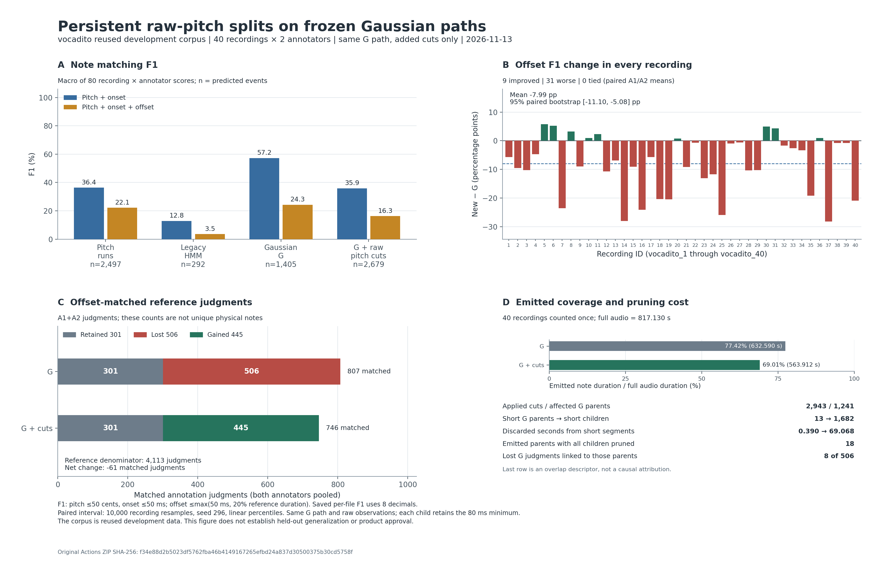

# 지속 raw-pitch 경계로 G 구간을 추가 분할한 결과

- 날짜: 2026-11-13 (Asia/Seoul)
- 이슈/PR: [#296](https://github.com/JDeun/audio-score-tool/issues/296) / [#297](https://github.com/JDeun/audio-score-tool/pull/297)
- 사전 정의: [원래 프로토콜](NOTE_BOUNDARY_READOUT_PROTOCOL_2026-11-13.md), [실행 명세](NOTE_BOUNDARY_READOUT_EXECUTION_2026-11-13.md)
- 최종 실험: [run 43381098932, attempt 1](https://github.com/JDeun/audio-score-tool/actions/runs/43381098932), [job 131738781820](https://github.com/JDeun/audio-score-tool/actions/runs/43381098932/job/131738781820)
- 최종 frozen head: `f1c1e2acafadedcea4578f732130f8a2d60ce21b`; 실제 PR checkout: `3b14f5692ac527ed3c31c8a0ebefc0d379e4f6bb`
- 상태: **전체 실행·private 독립 감사·다운로드한 원본의 공개 후검증 완료. 후보는 채택하지 않는다.** 코드 통합의 최종 head·병합·실제 main 검증은 PR #297에 기록한다.

## 판단

추가 분할은 붙어 있던 합성 반음 **6/6개를 회복**하고 기존 G 성공 **221/221개를 보존**했다. 하지만 실제 40개 녹음에서는 offset-inclusive F1이 **24.270837%→16.279944%**, onset F1이 **57.225361%→35.916666%**로 떨어졌다. 주 대비는 **−7.990893 percentage points(pp)**, 사전 고정한 recording-paired 95% bootstrap 구간은 **[−11.101802, −5.076088]pp**다. Offset은 9개 개선/31개 악화, onset은 1개 개선/39개 악화했다.

고정 G 경로 안에 2,943개 cut이 추가되면서 1,418개 부모가 4,361개 자식으로 나뉘었다. 짧아서 삭제되는 조각은 13개에서 1,682개로 늘었고, 최종 음 출력 시간은 68.677875초 줄었다. 유성 경로를 보존해도 음표 출력이 보존되지는 않았다. 이 결과는 원래 가설의 작은 합성 기전을 확인하지만 실제 경계 정확도 개선을 지지하지 않는다. 사전 지정한 offset 증가와 onset 비감소 조건을 모두 충족하지 못했다.

**제품의 기본값·자동 보정·모델 의존성은 바꾸지 않는다.** G는 후속 연구의 기준선으로 남기며, 이 연구만으로 G 자체를 제품에 승인하지도 않는다. 다음 별도 가설은 [#298](https://github.com/JDeun/audio-score-tool/issues/298)의 [부모 보존 승인 규칙](NOTE_BOUNDARY_PARENT_GUARD_PROTOCOL_2026-11-13.md)이다. 아직 구현·실행하지 않았다.



[SVG](figures/note-boundary-readout-2026-11-13.svg)와 [그림 생성 코드](../../scripts/plot_note_boundary_readout_results.py)는 공개 metadata만 읽는다. 그림을 만들기 위해 모델이나 scorer를 다시 실행하지 않았다.

## 무엇을 고정하고 무엇만 바꿨는가

기준선은 Gaussian exponent 1 HMM(`gaussian_exponent_1`, 이하 G), 새 arm은 `gaussian_raw_hysteresis_split`이다. 같은 pYIN 관측과 정확히 같은 G state path를 쓴다. 원래 raw Hz 전체에 기존 5-frame hysteresis를 적용하고, 양성 pitch label 사이의 지속 변화점 중 원래 G 부모 내부에 있는 위치만 추가 cut으로 사용했다. 기존 경계를 삭제하거나 raw-zero gate를 추가하지 않았다.

각 자식은 기존 raw-positive MIDI median→`rint`, 실제 audio duration clipping, positive raw support와 80ms 필터를 그대로 사용한다. 자식의 median pitch 변화는 구간이 달라진 결과다. Hysteresis label을 출력 pitch로 직접 대체하지 않았다. Emission/transition, acoustic frontend, pitch grid, Viterbi tie, 최소 길이, timestamp, scoring tolerance와 bootstrap을 탐색하지 않았다.

원래 vocadito 40개×11개 arm의 **440개 prediction**을 전부 저장한 다음 첫 human reference를 읽었다. A1/A2 모두 평가해 **880개 annotation score row**를 얻었다. 합성도 245개×8개 arm의 **1,960개 prediction**을 전부 저장한 다음 truth를 평가했다. 두 모집단의 평가 후 prediction manifest는 평가 전과 같다. 모든 계획한 case가 완료됐고, 실제 G/새 arm의 빈 출력은 모두 0개다.

Source는 [최종 frozen inventory 53개](NOTE_BOUNDARY_READOUT_FROZEN_SOURCES_2026-11-13.json)로 고정했다. 원래 #295의 35개 파일은 그대로다. 결과 문서·그림·다운로드 후 감사 helper는 실행 뒤 추가한 산출물이며 이 53개에 소급해 넣지 않는다.

## 실제 녹음의 성능과 정답 교체

F1은 pitch 50 cents, onset 50ms, offset `max(50ms, 20% reference duration)` 조건이다. 아래 onset 지표에도 pitch 조건이 포함된다. 원래 reference Hz와 파일별 8자리 F1을 유지하며, 40개 녹음×두 주석자를 동일 가중한 macro다. Precision/recall도 같은 cell 단위 macro이므로 전체 match 수를 한 번 나눈 micro 비율과 다르다.

| Arm | 예측 음 수 | Onset F1 % | Onset P % | Onset R % | Offset F1 % | Offset P % | Offset R % |
|---|---|---|---|---|---|---|---|
| Runs | 2497 | 36.353202 | 33.789840 | 40.481840 | 22.149227 | 20.702703 | 24.517944 |
| 기존 HMM | 292 | 12.832055 | 49.119307 | 7.607332 | 3.528561 | 10.767992 | 2.180670 |
| G | 1405 | 57.225361 | 69.333510 | 49.729823 | 24.270837 | 28.949870 | 21.372789 |
| G + raw-pitch split | 2679 | 35.916666 | 32.268960 | 41.564624 | 16.279944 | 14.629904 | 18.850001 |

새 arm의 예측은 G보다 **1,274개(+90.676157%)** 늘었지만 onset·offset precision과 recall은 모두 낮아졌다. G 대비 onset 변화는 −21.308695pp다. Runs 대비도 onset −0.436537pp, offset −5.869283pp이며, offset은 6개 개선/34개 악화다. Runs보다 출력이 많아졌다는 사실을 개선으로 해석하지 않는다.

주 대비의 paired 단위는 각 녹음의 A1/A2 평균 차이다. `default_rng(296)`, 10,000회 `(10000,40)` index 재표집, 선형 2.5/97.5 percentile을 그대로 재현했다. 이 구간은 재사용한 개발 녹음 40개의 기술적 불확실성을 표현하며 미사용 자료의 일반화 구간이 아니다.

### 실제 matched-reference 집합

분모는 A1+A2 합계 **4,113개 annotation judgment**다. 같은 실제 음에 대한 두 사람의 판단이 포함될 수 있으므로 고유 물리적 음표 4,113개라고 부르지 않는다. 아래 집합은 각 기준선과 새 arm의 실제 reference ID 매칭을 비교한 결과다.

| 새 arm의 비교 기준 | 기준 | 유지 | 획득 | 손실 | 기준선 matched | 새 matched |
|---|---|---|---|---|---|---|
| G | onset | 1015 | 663 | 914 | 1929 | 1678 |
| G | onset_offset | 301 | 445 | 506 | 807 | 746 |
| Runs | onset | 1555 | 123 | 81 | 1636 | 1678 |
| Runs | onset_offset | 637 | 109 | 343 | 980 | 746 |

G 대비 offset 정답은 807→746건(−61), onset 정답은 1,929→1,678건(−251)이다. Offset 445건을 새로 맞혔지만 506건을 잃었다. F1 하락은 늘어난 예측 수만의 현상이 아니라 실제 정답 손실도 동반한다.

### A1/A2와 전체 녹음별 변화

| 주석자 | G onset F1 % | 새 onset F1 % | 차이 pp | G offset F1 % | 새 offset F1 % | 차이 pp | Offset matched G→새 |
|---|---|---|---|---|---|---|---|
| A1 | 56.012559 | 37.546366 | -18.466193 | 24.257788 | 17.083221 | -7.174567 | 427→407 |
| A2 | 58.438162 | 34.286965 | -24.151197 | 24.283887 | 15.476667 | -8.807219 | 380→339 |

두 주석자 모두 평균상 악화했다. 녹음별 offset 변화 방향이 A1/A2에서 반대인 것은 11개(6, 10, 11, 20, 22, 26, 27, 33, 36, 38, 39)다. 이를 한쪽 주석자를 선택할 근거로 사용하지 않는다. 아래 표는 녹음 ID 순서이며 모든 40개를 포함한다. F1은 %, 차이는 pp, cuts와 short children은 annotation을 중복하지 않은 실제 출력 진단이다.

| 녹음 | G offset % | 새 offset % | Offset Δ pp | Onset Δ pp | A1 offset Δ pp | A2 offset Δ pp | Cuts | Short children |
|---|---|---|---|---|---|---|---|---|
| 1 | 27.588933 | 21.931708 | -5.657224 | -21.610007 | -9.687924 | -1.626525 | 63 | 39 |
| 2 | 27.038426 | 17.548362 | -9.490064 | -15.985135 | -9.823063 | -9.157065 | 72 | 33 |
| 3 | 36.339869 | 26.046088 | -10.293781 | -20.507378 | -15.032679 | -5.554882 | 56 | 44 |
| 4 | 19.879249 | 15.221307 | -4.657942 | -19.840372 | -6.228473 | -3.087410 | 67 | 37 |
| 5 | 14.111365 | 19.932298 | +5.820932 | +4.883593 | +6.638616 | +5.003249 | 99 | 51 |
| 6 | 13.298491 | 18.543499 | +5.245009 | -9.404328 | +12.411674 | -1.921656 | 91 | 41 |
| 7 | 40.114527 | 16.537717 | -23.576809 | -32.612047 | -34.199134 | -12.954484 | 53 | 38 |
| 8 | 21.940299 | 25.136298 | +3.196000 | -5.540957 | +5.882353 | +0.509647 | 38 | 23 |
| 9 | 28.592233 | 19.608066 | -8.984167 | -18.400453 | -6.288944 | -11.679389 | 81 | 50 |
| 10 | 10.314685 | 11.303483 | +0.988798 | -28.535922 | -0.871795 | +2.849390 | 46 | 23 |
| 11 | 13.520409 | 15.805204 | +2.284796 | -21.062960 | +7.007233 | -2.437642 | 53 | 30 |
| 12 | 34.305556 | 23.598015 | -10.707541 | -35.559002 | -12.884615 | -8.530466 | 38 | 21 |
| 13 | 17.398795 | 10.486012 | -6.912783 | -25.413155 | -7.475574 | -6.349992 | 105 | 50 |
| 14 | 34.821429 | 6.805243 | -28.016186 | -31.650227 | -23.351648 | -32.680723 | 66 | 31 |
| 15 | 19.688644 | 10.603773 | -9.084871 | -9.901998 | -8.221024 | -9.948718 | 62 | 40 |
| 16 | 31.124498 | 7.001014 | -24.123484 | -30.667574 | -21.296615 | -26.950354 | 69 | 47 |
| 17 | 17.104072 | 11.437452 | -5.666620 | -17.639289 | -6.857717 | -4.475524 | 66 | 34 |
| 18 | 40.700483 | 20.339209 | -20.361273 | -38.826051 | -15.081522 | -25.641025 | 90 | 56 |
| 19 | 27.298870 | 6.832298 | -20.466572 | -36.868646 | -19.628797 | -21.304348 | 147 | 78 |
| 20 | 22.431866 | 23.169399 | +0.737534 | -22.430663 | -2.550091 | +4.025158 | 36 | 29 |
| 21 | 21.070775 | 11.874244 | -9.196532 | -14.355758 | -7.012623 | -11.380441 | 98 | 50 |
| 22 | 17.533990 | 16.823529 | -0.710460 | -13.155318 | -4.253165 | +2.832244 | 62 | 41 |
| 23 | 27.487923 | 14.415585 | -13.072339 | -31.462607 | -11.801243 | -14.343434 | 76 | 56 |
| 24 | 27.045454 | 15.365168 | -11.680286 | -34.393194 | -9.269663 | -14.090909 | 47 | 22 |
| 25 | 42.399403 | 16.512476 | -25.886928 | -49.229755 | -27.063740 | -24.710116 | 63 | 42 |
| 26 | 23.001725 | 22.022398 | -0.979327 | -5.346647 | +3.480754 | -5.439408 | 62 | 41 |
| 27 | 27.652520 | 27.071520 | -0.581000 | -23.385247 | +5.284371 | -6.446371 | 45 | 26 |
| 28 | 19.029989 | 8.719541 | -10.310448 | -24.622032 | -8.578144 | -12.042752 | 58 | 40 |
| 29 | 29.019270 | 18.792996 | -10.226273 | -25.882899 | -5.877649 | -14.574898 | 48 | 29 |
| 30 | 4.837662 | 9.783435 | +4.945772 | -3.230865 | +2.110389 | +7.781155 | 53 | 29 |
| 31 | 22.154317 | 26.464647 | +4.310330 | -6.336898 | +5.483405 | +3.137255 | 49 | 27 |
| 32 | 11.339274 | 9.685325 | -1.653949 | -20.960279 | -1.631294 | -1.676605 | 88 | 42 |
| 33 | 11.632760 | 9.031861 | -2.600898 | -17.204066 | -8.018698 | +2.816902 | 137 | 67 |
| 34 | 17.844203 | 14.505348 | -3.338855 | -11.056569 | -5.541347 | -1.136364 | 93 | 65 |
| 35 | 40.979510 | 21.785714 | -19.193796 | -28.365006 | -12.008281 | -26.379310 | 56 | 35 |
| 36 | 20.162370 | 21.133094 | +0.970723 | -14.462012 | +6.034483 | -4.093036 | 97 | 62 |
| 37 | 43.750000 | 15.521757 | -28.228244 | -24.821157 | -22.191781 | -34.264706 | 104 | 50 |
| 38 | 11.902928 | 11.152084 | -0.750844 | -30.870880 | -6.618820 | +5.117132 | 101 | 62 |
| 39 | 17.346419 | 16.537245 | -0.809174 | -8.486636 | +7.312174 | -8.930523 | 139 | 61 |
| 40 | 37.030303 | 16.113360 | -20.916943 | -27.147405 | -19.282052 | -22.551834 | 69 | 40 |

## 추가 cut과 최소 길이 삭제의 비용

| 측정 | G 부모 readout | 새 자식 readout |
|---|---|---|
| Prefilter segments | 1418 | 4361 |
| Emitted notes | 1405 | 2679 |
| 80ms 미만으로 삭제한 segments | 13 | 1682 |
| 삭제한 짧은 구간 초 | 0.390000 | 69.067875 |
| 최종 출력 초 | 632.590250 | 563.912375 |

전체 raw 후보 3,034개 중 G 부모 내부에 실제 적용된 cut은 2,943개다. 1,418개 부모 중 1,241개가 영향을 받았다. 원래 출력된 부모 중 1,074개는 short child를 가지며, 14개 녹음에 걸친 18개 부모는 모든 자식이 삭제됐다. 전체 audio 길이 817.1296875초를 한 번씩 센 가중 출력 coverage는 **77.416138%→69.011368%**다. G가 출력하던 시간의 10.856613%가 줄었다.

원래/새 readout의 raw voiced frames, decoded path, raw-voiced→Silent 프레임 수는 동일하다. 두 방법의 emitted raw-unvoiced bridging은 모두 0이다. 원래 source의 유성 경로와 최종 출력 시간은 다른 수준의 양이다.

G에서 잃은 offset 판단 506건은 모두 cut이 들어간 부모에 연결된다. 그중 436건은 short child가 있는 부모, 8건은 모든 자식이 삭제된 부모에 연결된다. Onset 손실 914건의 해당 수는 914/796/11이다. 이들은 겹치는 설명 변수이고 단독 원인 배분이 아니다. 특히 18개 부모의 완전 삭제만으로 전체 손실을 설명할 수 없다. 분할에 따른 pitch median 변화, onset/offset 이동과 matching 재배정도 함께 작용할 수 있으나 이 보고서는 각각의 독립 인과 효과를 추정하지 않는다.

## 같은 onset 매칭 쌍에서 본 종료점

각 arm의 onset-only 매칭 쌍을 고정한 뒤 그 쌍의 종료점을 평가했다. Positive residual은 예측이 reference보다 늦게 끝났다는 뜻이다. Early/within/late는 같은 reference의 offset tolerance를 적용하며, offset을 포함해 다시 최적 매칭한 집합과 같다고 가정하지 않는다. 따라서 within 800/739와 offset-matched 807/746은 서로 다른 계산이다.

| Arm | Onset pair 수 | Early | Within | Late | Residual Q25 ms | Median ms | Q75 ms | Mean ms |
|---|---|---|---|---|---|---|---|---|
| Runs | 1636 | 357 | 969 | 310 | -39.019275 | +16.553288 | +43.877551 | -24.725581 |
| G | 1929 | 7 | 800 | 1122 | +43.129252 | +69.523810 | +128.979592 | +136.380898 |
| G + raw-pitch split | 1678 | 291 | 739 | 648 | -11.541950 | +40.249433 | +70.402494 | +6.364820 |

G→새 arm의 residual 평균은 +136.380898→+6.364820ms, 중앙값은 +69.523810→+40.249433ms로 낮아졌다. 그러나 평가 대상 onset 쌍 자체가 1,929→1,678개로 바뀌었고 early가 7→291개로 늘었다. 평균에는 early/late의 상쇄도 있다. **이 수치 감소를 같은 음들의 종료점이 개선됐다는 증거로 쓰지 않는다.** 실제 offset F1과 맞힌 reference 수는 감소했다. 표의 pooled quartile은 private 원본 쌍을 모아 계산한 값이며, 파일별 중앙값을 평균해 만든 값이 아니다.

## 합성: 작은 기전은 해결했고 실제 전이는 실패했다

기존 245개는 accuracy-eligible 227개, ambiguity 15개(동음 zero-gap 9개, dropout 6개), silence 3개다. 새로운 자료로 바꾸거나 모호한 사례를 정답 평균에 끼워 넣지 않았다.

| 범위 | G | 새 분할 | 해석 |
|---|---:|---:|---|
| 붙은 반음 6개 | 두 reference를 맞힌 case 0/6 | 6/6 | 알려진 병합 기전을 회복 |
| 이전 G 성공 221개 | 221/221 | 221/221 | 기존 성공 손상 0 |
| Eligible onset/offset F1 macro | 97.356828% / 97.356828% | 100% / 100% | 이 고정 저작 격자에서의 결과 |
| 추가 cut 없음 / event 동일 | — | 239/245 / 239/245 | 여섯 조건에서만 event 변경 |
| Silence false positive | 0 | 0 | 세 silence case 모두 빈 출력 |
| Short child / 완전 삭제 부모 | 0 / 0 | 0 / 0 | 실제 녹음의 삭제 비용을 드러내지 못함 |
| 출력 길이 | 144.34초 | 144.34초 | 합성에서는 출력 시간 보존 |

여섯 ID는 `change_195`, `change_197`, `change_207`, `change_209`, `change_219`, `change_221`이다. 모두 한 음에서 두 음으로 바뀌고 두 음의 pitch/onset/offset을 모두 맞혔다. 전체 raw 후보는 18개, 실제 추가 cut은 6개, 부모 323→자식 329개다. Ambiguity의 두 해석과 silence 결과는 그대로다.

이 격자에서 실제 추가 cut은 여섯 개뿐이고 short child가 없었다. 정수 MIDI 중심의 기존 ±0.3 modulation도 반올림 경계를 넘지 않는다. 따라서 227/227은 실제 보컬의 표현 변화에 안전하다는 증거가 아니다. 다음 실험은 원래 격자를 보존하면서 경계를 넘는 단일음 modulation과 실제 인접음 조건을 별도 모집단으로 추가한다. 실제 cut 2,943개의 원인을 모두 vibrato라고 단정하지 않는다.

## 실패를 포함한 실행 이력

세 실행은 서로 다른 frozen head의 별도 실행이며 모두 attempt 1이다. 실패 ZIP과 해당 문서는 수정하지 않았다.

| 실행 | Frozen head | 중단/완료 지점 | 원본 ZIP bytes |
|---|---|---|---:|
| [43377739964](https://github.com/JDeun/audio-score-tool/actions/runs/43377739964) | `b64b0bd521c9c6433a581f876f6afe7b654edeb5` | 합성 historical input exact parity 실패; corpus 시작 전 | 173,771 |
| [43379624835](https://github.com/JDeun/audio-score-tool/actions/runs/43379624835) | `86c18a9eb3a1b2ba617a5daaa14a8c74a088fe82` | 합성 complete, 실제 40개 예측·평가 뒤 legacy report projection 오류 | 579,798 |
| [43381098932](https://github.com/JDeun/audio-score-tool/actions/runs/43381098932) | `f1c1e2acafadedcea4578f732130f8a2d60ce21b` | 전체 실행과 두 private auditor 완료 | 775,843 |

### 첫 실패: 같은 NumPy 버전의 수치 dispatch 차이

첫 실행은 기존 synthetic event 1,715개와 path 1,470개, 진단·점수는 같았지만 input SHA 18개와 analytic float 10개가 달랐다. 동일 NumPy 1.26.4에서 AVX512F dispatch를 제외한 별도 input-only probe가 28개 차이를 정확히 재현했다. 첫 실제 host의 CPU feature는 기록되지 않아 host 모델이나 feature를 관측했다고 주장하지 않는다. NumPy 버전 불일치라고 설명하지도 않는다.

[수치 환경 복구 명세](NOTE_BOUNDARY_READOUT_RECOVERY_2026-11-13.md), [진단 원본](receipts/note-boundary-readout-numeric-diagnosis-2026-11-13.json), [첫 실패 ZIP](receipts/note-boundary-readout-43377739964.zip)을 보존했다. 알고리즘과 hash 허용 조건은 그대로 두고 실제 runtime/CPU metadata와 245개 입력·20개 analytic 행의 exact preflight를 추가했다. 이 manifest에는 truth/event/path/score가 없다. 실제 예측 실행에서는 CPU feature를 강제로 켜거나 끄지 않았으며, 통과한 동일 배열을 실제 예측에 사용했다.

### 두 번째 실패: immutable 설정의 보고서 복사

두 번째 실행은 preflight와 합성 parity를 통과했고 실제 40개도 모두 예측·평가했다. 이후 live `_FrozenDict`인 `FACTOR_SETTINGS`를 `deepcopy`하면서 `TypeError: experiment settings are immutable`이 발생했다. Archive fixture의 일반 dict로는 이 오류가 나타나지 않았다. 완결 aggregate는 제거되고 private auditor는 실행되지 않았다.

[보고서 수정 명세](NOTE_BOUNDARY_READOUT_REPORT_RECOVERY_2026-11-13.md)와 [두 번째 실패 ZIP](receipts/note-boundary-readout-43379624835-attempt-1.zip)을 보존했다. 설정을 바꾸지 않고 legacy projection 복사 한 곳을 JSON snapshot으로 바꿨으며 live immutable 객체의 회귀 테스트를 추가했다. 이후 최종 head에서 전체 예측·평가·감사를 다시 실행했다.

[별도 recovery 비교](receipts/note-boundary-readout-recovery-comparison-43381098932.json)는 두 번째 실패와 최종 실행 사이의 corpus 440개 event/440개 array/880개 annotation score row, synthetic 1,960개 event/245개 input/1,470개 path와 전체 245개 scientific row가 정확히 같음을 확인한다. Corpus row에서 달라진 것은 40개의 inference timing뿐이다. Runtime metadata도 같다. 예측·평가·threshold를 고쳐 결과를 선택한 것이 아니다.

최종 실제 환경은 Python 3.11.18, NumPy 1.26.4, SciPy 1.13.1, librosa 0.10.2.post1, numba 0.60.0, soundfile 0.13.1, resampy 0.4.2, soxr 1.1.0, mir_eval 0.8.2다. NumPy의 AVX512F feature는 true였고 disable-feature 환경 변수는 없었다. CPU 2 threads, 35분 한도를 유지했다. 보고서의 실측 시간은 합성 11.838220초, corpus 168.558764초, 새 private audit 6.425124초다. 설치·다운로드를 포함한 job 전체 시간이나 제품 지연시간으로 해석하지 않는다.

## 원본 보존, exact parity와 독립 감사

최종 artifact **14017370366**의 [원본 ZIP](receipts/note-boundary-readout-43381098932-attempt-1.zip)은 **775,843 bytes**, SHA256 **`f34e88d2b5023df5762fba46b4149167265efbd24a837d30500375b30cd5758f`**다. 내려받은 bytes를 재압축하지 않았다. 허용한 여섯 member만 있으며 모두 complete/pass다.

| Member | Bytes | SHA256 |
|---|---|---|
| `legacy-synthetic.json` | 2847165 | `0f26fe94af8250d043d5db4a5f4882dc623470139b53ec1534a7bd0229f82148` |
| `synthetic.json` | 4141302 | `ba952f6445fc533442b00731c685470123765c4aee6aebe80f9ac03d34c27f79` |
| `vocadito.json` | 2717191 | `86717fa141d5387a35a8bab44b37bf4fdd386c807f13dafb691861f232fb810d` |
| `legacy-vocadito.json` | 1625568 | `beb650518da6a5bd786f298bc8bd03de1727729402b73100fea04f444906bb28` |
| `legacy-audit.json` | 282759 | `43ad22ceca3fdc32c646b518aa48b6e6473f6832d44ced3ca62622d6c3a06b50` |
| `audit.json` | 83753 | `25a61553f0fe88129c7cb2d4e2e724e8a8495dbe8d9735cff450e2a42467bbf3` |

첫 실패 ZIP SHA256은 `522db7f66bea3dc6b05774c6dd1a82d450b6edfc076a4f7d79230de026f9e7bc`, 두 번째 실패 ZIP은 `1c62896a6e6f3408d12fb82ddc42ec844bf8e5827dbe27fb5757e2db7d41383a`다. 앞선 실행을 성공 artifact로 덮어쓰지 않는다.

원래 #295 receipt와 비교한 corpus **400개 prediction/440개 array**, synthetic **1,715개 prediction/245개 input/1,470개 path**가 모두 정확히 같다. 이전 35개 source도 같다. Legacy JSON 전체 bytes는 실행 revision, timing 등 provenance 때문에 달라질 수 있으므로 원본 ZIP identity와 scientific payload parity를 구분한다.

| 검증 | 범위 | 결과 |
|---|---|---|
| 기존 private factor auditor | 정확한 legacy projection, 기존 예측·관측·reference·점수 | 42,867 checks pass |
| 새 private readout auditor | 440 corpus/1,960 synthetic event files, 440 arrays, 80 reference files, 285개 새 readout 독립 재구성, raw cuts·부모/자식·매칭·bootstrap | 325,886 checks pass; 최대 수치 차이 7.105427357601002e−15 |
| 다운로드 후 공개 auditor | 원본 bytes/6 members/53 sources, 880개 corpus score 산술, 집합 비교와 bootstrap, 소유 input 245개 재생성·hash, event 1,960개 hash, eligible 1,816개 score pair 직접 재평가 | 116,060 checks pass; 최대 수치 차이 1.1102230246251565e−16 |
| 두 번째 실패→최종 비교 | 모든 corpus/synthetic 예측·배열·점수·진단 identity | exact; corpus timing만 차이 |

[공개 후검증 receipt](receipts/note-boundary-readout-postrun-audit-43381098932.json)는 32,804 bytes, SHA256 `b30d758b13627e7354207ade925aae56c2f7a931313a210c99286c51458b6f51`다. [실제로 실행한 helper](../../scripts/audit_note_boundary_readout_receipt.py)는 SHA256 `cccd9bde3c87ae0b72edecb888a557f8536baaf5918c6edc26d9944cdae40734`, [freeze map](NOTE_BOUNDARY_READOUT_FROZEN_SOURCES_2026-11-13.json)은 SHA256 `c8117eaeacc2d71cba3443481a61b5c6ab2e4d5e0b2687661e5631d23a054670`로 함께 보존했다. 회복 비교 receipt는 6,401 bytes, SHA256 `6c8c8ac11b7341a033f900f023d97e76e53f14bb8f2accf24a76c2180b7e6737`다.

공개에는 실제 WAV, reference CSV 내용, 실제 event/F0/path 배열이나 부모·자식의 개별 musical trace를 넣지 않았다. 직접 저작한 synthetic truth/events는 포함된다. 공개 감사는 corpus score 산술과 집합 비교를 검산하지만 비공개 reference를 직접 rematch하거나 pooled residual quartile·개별 부모 손상 연결을 다시 만들지는 못한다. 해당 항목은 정확한 파일 hash로 연결된 private auditor가 검증했다. Direct mir_eval은 같은 matching library를 다시 호출한 것이며 독립 human truth가 아니다. Hash만으로 과거 reference 접근 순서를 증명할 수 없으므로 frozen runner·barrier 계약·workflow·전후 manifest를 함께 보존한다.

## 재현 명령과 코드 검증

다음 공개 후검증은 모델, pYIN 또는 decoder를 호출하지 않는다. NumPy 1.26.4, mir_eval 0.8.2와 기존 numeric 환경에서 실행한다. Exact input preflight가 다른 CPU dispatch의 수치 차이를 검출하면 완화하지 않는다. 새 출력 경로를 지정해야 하며 원래 receipt를 덮어쓰지 않는다.

```bash
python scripts/audit_note_boundary_readout_receipt.py \
  --artifact docs/research/receipts/note-boundary-readout-43381098932-attempt-1.zip \
  --expected-sha256 f34e88d2b5023df5762fba46b4149167265efbd24a837d30500375b30cd5758f \
  --expected-bytes 775843 \
  --repository . \
  --frozen-head f1c1e2acafadedcea4578f732130f8a2d60ce21b \
  --source-map docs/research/NOTE_BOUNDARY_READOUT_FROZEN_SOURCES_2026-11-13.json \
  --run-id 43381098932 \
  --output /tmp/note-boundary-readout-audit-new.json

python -m scripts.plot_note_boundary_readout_results \
  --receipt docs/research/receipts/note-boundary-readout-43381098932-attempt-1.zip \
  --output-dir /tmp/note-boundary-readout-figures
```

최종 scientific head의 workflow는 **582개 계약 테스트**를 통과했다. 신규 계약은 198개이며 raw-pitch cut, 원래 G parity, 자식 pruning, 전체 예측 barrier, immutable report 복사와 독립 감사 변조 검출을 포함한다. [해당 head CI](https://github.com/JDeun/audio-score-tool/actions/runs/43381098764)는 product 2,119 passed/기존 optional skip 9, research 2,218 passed/기존 dependency warning 1, frontend 69 passed다. Test inventory는 product 200/research 74개 파일, 누락 0이다. [Evidence Contracts](https://github.com/JDeun/audio-score-tool/actions/runs/43381098891)도 통과했다.

이는 scientific 실행 head의 증거다. 결과 산출물 추가 뒤의 최종 head 및 실제 병합 main의 CI·compatibility·security 결과는 [PR #297](https://github.com/JDeun/audio-score-tool/pull/297)에 각각 기록한다. PR에서 research-only Tauri가 skipped인 사실을 main의 실제 build 통과로 대신하지 않는다.

## 모든 기존 arm의 결과와 후속 범위

이전 arm을 삭제하거나 좋은 결과만 비교하지 않았다. 전체 11개 arm의 macro는 다음과 같다.

| Arm | 예측 음 수 | Onset F1 % | Offset F1 % |
|---|---|---|---|
| `pitch_runs` | 2497 | 36.353202 | 22.149227 |
| `pitch_hysteresis` | 2757 | 35.124455 | 13.906851 |
| `pitch_hysteresis_reattack` | 2785 | 35.346152 | 14.170140 |
| `note_state_hmm` | 292 | 12.832055 | 3.528561 |
| `note_state_hmm_rms` | 332 | 14.215365 | 5.290052 |
| `gaussian_exponent_1` | 1405 | 57.225361 | 24.270837 |
| `phase_balanced` | 936 | 38.535521 | 10.378880 |
| `positive_voicing_08` | 982 | 37.246776 | 9.514355 |
| `silent_self_099` | 482 | 20.794958 | 6.976237 |
| `hop_unscaled` | 274 | 11.358912 | 3.141983 |
| `gaussian_raw_hysteresis_split` | 2679 | 35.916666 | 16.279944 |

이번 결과로는 지속 raw pitch 변화 자체를 곧바로 음표 경계로 추가하는 방식이 실제 보컬에서 안전하다고 볼 수 없다. 다음 [#298](https://github.com/JDeun/audio-score-tool/issues/298)은 모든 자식이 기존 readout을 통과할 때만 부모 전체 분할을 승인하고, 하나라도 실패하면 원래 G event를 유지하는 한 요인을 시험한다. 원래 non-emitted 부모는 되살리지 않는다. Proposed short children과 실제 삭제량을 분리하고, 출력 시간 구간 합집합 보존을 독립 계약으로 확인한다.

이 guard도 80ms 이상인 잘못된 split을 막는다고 보장하지 않는다. 기존 245개와 실제 40개를 보존하면서 새 단일음 modulation 108개/실제 인접 반음 108개를 따로 검사하도록 사전 정의했다. 아직 성능은 측정하지 않았다.

같은 corpus와 authored grid는 반복 사용한 개발 자료다. 미사용 실제 녹음, 사용자 수정 비용, 다성음 처리, 실제 음정·길이 편집의 재합성 품질과 [#281](https://github.com/JDeun/audio-score-tool/issues/281)의 공통 악보 복원은 별도 문제로 남아 있다. 이 추가 분할은 Melodyne/Flex Pitch의 비공개 알고리즘을 재현한 것이 아니다.
