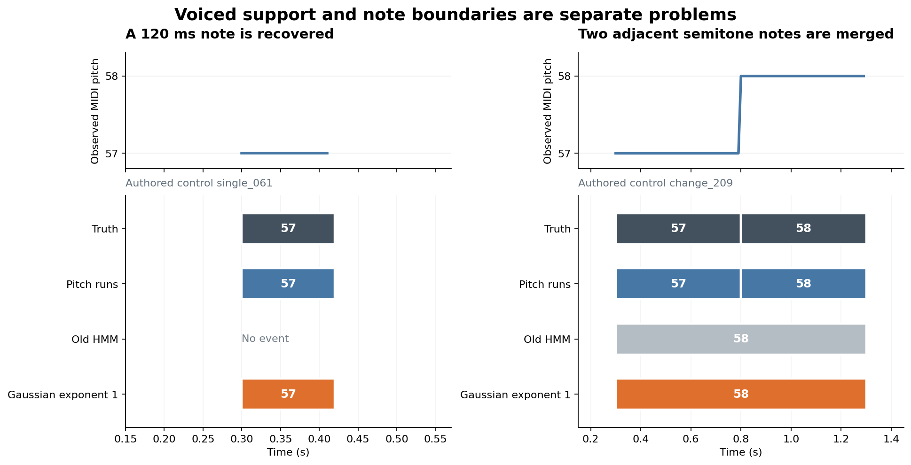

# Note-state HMM 가정별 실험 — Gaussian 개선과 남은 경계 손실

2026-11-13 Asia/Seoul. 실행 [#291](https://github.com/JDeun/audio-score-tool/issues/291),
[PR #292](https://github.com/JDeun/audio-score-tool/pull/292),
후속 [#293](https://github.com/JDeun/audio-score-tool/issues/293).
[실행 전 고정 프로토콜](NOTE_STATE_FACTORS_PROTOCOL_2026-11-13.md),
[공개 소스 감사](TONY_NOTE_HMM_SOURCE_AUDIT_2026-11-13.md),
[이전 실패 결과](NOTE_STATE_HMM_RESULTS_2026-11-13.md)를 함께 읽는다.

## 판단

**사전에 지정한 Gaussian exponent 비교는 기존 HMM보다 크게 개선됐다. 제품 기본값은 변경하지 않는다.**
Gaussian PDF 지수만 0.1→1로 바꾼 `gaussian_exponent_1`(이하 G)은 기존 HMM 대비
pitch+onset+offset F1을 **3.528561%→24.270837%**로 높였다.
차이는 **+20.742276 percentage points**, 40개 녹음 모두 개선이다.
고정한 recording 단위 paired percentile 95% 구간은 **[+17.968746, +23.611651] pp**다.

실용 기준선 `pitch_runs` 대비 onset F1은 **36.353202%→57.225361%**,
offset 포함 F1은 **22.149227%→24.270837%**로 개선됐다.
그러나 offset 기준으로 20개 녹음이 개선되고 20개는 악화됐다.
Offset recall과 맞힌 reference judgment 총수는 오히려 감소했다.
따라서 사전 지정한 후속 연구의 최소 조건은 충족했지만, 안전한 제품 교체나
종료 경계의 일관된 회복을 입증한 결과는 아니다.

이번 연구는 과도한 Silent 선택의 원인을 분리하려는 제한된 비교다.
기존 설정에서 Gaussian exponent 선택이 큰 영향을 준다는 근거를 얻었고,
관측 지원을 회복한 뒤에도 작은 pitch 변화의 note 병합이 남는다는 점을 확인했다.
다음 연구는 [#293의 offset 손실·붙은 반음 전환 진단](https://github.com/JDeun/audio-score-tool/issues/293)으로 좁힌다.
`quality_approved=false`, 제품 source·기본값·dependency 변경 없음,
미사용 녹음 일반화와 [#281](https://github.com/JDeun/audio-score-tool/issues/281)의 악보 복원은 미검증이다.

## 공개 소스에서 확인한 차이

[2015 Tony 논문](https://www.tenor-conference.org/proceedings/2015/04-Mauch-Tony.pdf)의
식은 Gaussian PDF 자체에 지수 0.1을 적용한다. 반면 감사한 공개 pYIN 소스는
후보 확률에 지수를 적용하고 Gaussian PDF에는 적용하지 않는다.
이 차이는 Tony 1.0과 대응한다고 changelog에 기록된 2015 v1.1 태그에도 있다.
논문과 코드가 다른 이유, 논문 평가 binary의 정확한 revision은 확인되지 않았다.
따라서 이전 논문식 adaptation을 단순 구현 버그로 소급 정정하지 않는다.

공개 note 출력 경로는 양성 smoothed F0 하나에 후보 확률 0.9를 붙인다.
이 경우 후보 확률의 지수항은 joint 정규화에서 상쇄되고, non-silent mass는 0.8이다.
전체 pYIN 후보 posterior를 note HMM에 반드시 전달해야 한다는 결론도 맞지 않는다.
다만 이번 G는 exponent 하나만 변경했다. 공개 구현의 다른 voicing 처리,
sigma, 초기 상태, pitch range, jump kernel, lag, timestamp, raw-F0/RMS gate,
최소 길이와 출력 pitch 규칙은 함께 복원하지 않았다.
전체 Tony 또는 Melodyne/Flex Pitch의 재현·성능 시험으로 해석하지 않는다.
Revision별 근거와 permalink는 [소스 감사](TONY_NOTE_HMM_SOURCE_AUDIT_2026-11-13.md)에 고정돼 있다.

## 실행과 원본 증거

[CPU run 43344373779](https://github.com/JDeun/audio-score-tool/actions/runs/43344373779),
[job 131620034765](https://github.com/JDeun/audio-score-tool/actions/runs/43344373779/job/131620034765)가
**첫 시도에서 성공**했다. 고정 환경 검사, Ruff, 신규 contract **140개(0 skips)**,
합성 245개, 실제 녹음 40개, 독립 private-file 재채점과 artifact 보존을 모두 완료했다.
모든 실제 arm이 40/40 완료됐고, 실패 녹음과 빈 실제 출력은 없었다.

| 항목 | 고정 식별자 |
|---|---|
| 기준 main | `80ce419eee2d73890f6dddbbb9cecfc6c68bff7a` |
| 실행 전 remote head | `7f801858f4d2b432e90f4b2c73a99dbe00d5bfd1` |
| 실제 Actions merge checkout | `8eb7c429572d23249f45befcddc4347ff20825ec` |
| Frozen tree | `18756fdf2426fcbb599dc15ecb769d13c2e682b1` |
| 같은 tree의 검토된 local commit | `0ebdc7ba2030ebe41be4c5f8aa616041ea8eefb0` |
| 원 artifact | `14001615849`, 272,995 bytes |
| 원 ZIP SHA256 | `b20495c8936f8b4263daf2660fb57ba282264904d6b30dda076463cc6e3881f6` |

[원본 ZIP](receipts/note-state-factors-43344373779.zip)은 재압축하지 않았다.
멤버는 다음 세 개뿐이다.

| 멤버 | Bytes | SHA256 |
|---|---:|---|
| `synthetic.json` | 2,847,165 | `c8fa27a7b0cd2b87d93f87ae1cbbca58283881906a3b992ab5a24ef30128cf2a` |
| `vocadito.json` | 1,625,637 | `c44d3b1fc6148fc2b297c0ebec8216b59201615ab4acb4b9aa388436a5e489fb` |
| `audit.json` | 282,759 | `b10c2202fc34e087cf47c33625d07d1f25ece6a181cba208f56adb79125615e1` |

실제 WAV·reference 본문·full F0/path·실제 note JSON은 포함하지 않는다.
직접 만든 synthetic의 정답과 예측 이벤트는 공개한다.
CPU 2 threads에서 synthetic은 **11.178 s**, corpus 추론·평가는 **168.135 s**,
corpus peak RSS는 **736,912 KiB**였다. 설치·원본 다운로드·감사 시간은 이 corpus 시간에 포함하지 않는다.
실험 후 모델·프로토콜·workflow 등 frozen scientific 24개 파일은 변경하지 않았다.

## 실제 녹음의 10개 고정 조건

동일한 원본 vocadito 40개에 새 pYIN을 각각 한 번 실행했다.
모든 400개 예측을 저장·hash 고정한 뒤 80개 note reference와 40개 F0 reference를 읽었다.
각 녹음과 주석자 A1/A2에 동일 가중을 줬다. A1에는 2,237개, A2에는 1,876개의 reference note가 있다.
Pitch 50 cents, onset 50ms, offset `max(50ms, reference duration×20%)`이며 octave 오류도 오류다.
Reference Hz를 정수화하거나 시간·tolerance를 변경하지 않았다.

| Arm | Pitch+onset F1 | Pitch+onset+offset F1 | 예측 events | Offset F1: runs 대비 개선 / 악화 |
|---|---:|---:|---:|---:|
| `pitch_runs` | 36.353202% | 22.149227% | 2,497 | 기준선 |
| `pitch_hysteresis` | 35.124455% | 13.906851% | 2,757 | 1 / 39 |
| `pitch_hysteresis_reattack` | 35.346152% | 14.170140% | 2,785 | 1 / 39 |
| 기존 `note_state_hmm` | 12.832055% | 3.528561% | 292 | 1 / 39 |
| 기존 `note_state_hmm_rms` | 14.215365% | 5.290052% | 332 | 1 / 39 |
| **`gaussian_exponent_1`** | **57.225361%** | **24.270837%** | **1,405** | **20 / 20** |
| `phase_balanced` | 38.535521% | 10.378880% | 936 | 5 / 35 |
| `positive_voicing_08` | 37.246776% | 9.514355% | 982 | 4 / 36 |
| `silent_self_099` | 20.794958% | 6.976237% | 482 | 3 / 37 |
| `hop_unscaled` | 11.358912% | 3.141983% | 274 | 1 / 39 |

기존 5개 조건의 **200개 prediction 객체·hash·주석자 점수**,
기존 6개 배열의 **240개 dtype/shape/raw-byte hash**, 이전 frozen source 12개,
모든 원본/reference identity와 F0 점수·legacy diagnostics가 과거 결과와 정확히 일치했다.
원본 DSP의 120개 예측도 재현했다. 입력이나 과거 기준선이 바뀌어 생긴 개선이 아니다.
이전 raw arrays를 불러 쓴 것이 아니라, 새 배열을 기존 receipt의 identity와 대조했다.

### Primary와 실용 비교의 차이

사전 primary G−old HMM의 offset 차이는 +20.742276 pp이며,
40개 녹음의 A1/A2 평균에서 전부 양수다. A1 40개와 A2 40개도 각각 모두 개선됐다.
95% 구간은 고정 seed 291의 10,000회 recording 재표집으로 계산했으며,
반복 사용한 개발 표본의 기술적 구간이다. Heldout 일반화의 구간이 아니다.

G−runs는 onset +20.872158 pp(38개 개선/2개 악화), offset +2.121610 pp(20/20)다.
주석자별 offset macro도 각각 A1 22.637677%→24.257788%,
A2 21.660778%→24.283887%로 높아졌다. A1은 24/16, A2는 22/18개가 개선/악화됐다.
두 주석자 모두 개선한 녹음 18개, 모두 악화한 녹음 12개, 방향이 다른 녹음 10개다.

## Offset F1 상승이 의미하지 않는 것

| 지표 | Runs | G |
|---|---:|---:|
| Onset precision macro | 33.789840% | 69.333510% |
| Onset recall macro | 40.481840% | 49.729823% |
| Offset 포함 precision macro | 20.702703% | 28.949870% |
| Offset 포함 recall macro | 24.517944% | 21.372789% |
| A1/A2 합계 onset matched judgments | 1,636 | 1,929 |
| A1/A2 합계 offset matched judgments | 980 | 807 |

Onset은 실제 matched judgment도 293개 증가했다(980 gained / 687 lost).
반면 offset은 **557 gained / 730 lost**, 기존 250개 유지, 최종 807개로 순감소 173개다.
예측수는 2,497→1,405로 43.73% 감소했다. 파일·주석자별
`F1 = 2M / (R + P)`에서 prediction 수 P가 줄면 matched 수 M이 줄면서도 F1이 높아질 수 있다.
이번 offset 결과는 precision 상승과 recall 하락을 함께 가진다.
이를 더 많은 정확한 종료점을 보존했다고 표현하지 않는다.
또한 matching의 reference ID 교체를 사람이 확인한 물리적 음표 손상 수로 단정하지 않는다.

예를 들어 `vocadito_2`는 예측 77→34개, A1 offset match 18→15개인데
F1은 23.529412%→27.272727%다. A2도 match 14→13개와 F1 20.000000%→26.804124%가 함께 나타난다.
이처럼 평균 offset F1은 상승했지만 두 주석자 match 총합이 줄어든 녹음은
2, 13, 21, 28, 34의 5개다. 이는 고정된 전체 결과의 사후 설명이며 이들만 대상으로 규칙을 맞추지 않는다.

실제 녹음의 전체 note timestamps와 path는 public ZIP에 없으므로
손실의 early/late 방향이나 실제 병합 원인을 이 metadata만으로 확정할 수 없다.
후속 진단은 고정된 모델로 private evidence를 재구성하고 이번 예측/배열 hash를 재현한 뒤 수행해야 한다.

## 관측·전이 가정의 효과

모든 HMM 조건의 입력은 81,734 frames, raw voiced 64,502 frames다.

| HMM 조건 | Raw voiced→Silent | Dropout | 필터 전→최종 events | 짧은 조각 제거 |
|---|---:|---:|---:|---:|
| 기존 HMM | 31,575 | 48.951970% | 292→292 | 0 |
| 기존 HMM+RMS | 31,910 | 49.471334% | 388→332 | 56 / 1.62s |
| G | 1,200 | 1.860407% | 1,418→1,405 | 13 / 0.39s |
| Phase balanced | 1,837 | 2.847974% | 941→936 | 5 / 0.10s |
| Positive voicing 0.8 | 445 | 0.689901% | 985→982 | 3 / 0.11s |
| Silent self 0.99 | 20,207 | 31.327711% | 482→482 | 0 |
| Hop unscaled | 31,710 | 49.161266% | 274→274 | 0 |

G의 decoded voiced는 63,304프레임이며 raw voiced를 유지한 것은 63,302프레임이다.
추가 2프레임은 raw unvoiced 위의 support지만 짧은 조각 제거에 포함됐다.
최종 note에 포함된 raw-unvoiced frame은 **모든 조건에서 0**이다.
G의 개선은 80ms 필터를 바꾼 결과가 아니며, 필터 전 segmentation 자체가 달라졌다.

더 높은 coverage만으로 note 품질을 설명할 수도 없다.
Voicing 0.8은 G보다 dropout이 적지만 offset F1은 9.514355%다.
Phase balance도 coverage를 크게 회복했지만 offset F1은 10.378880%에 머문다.
이것은 사전 고정된 OAT 결과이며, 가장 좋은 조합을 찾거나 interaction을 평가한 결과가 아니다.

### 분석적 emission 설명

MIDI 57의 양성 관측에서 기존 exponent .1 / joint 정규화는
Attack 총질량 0.401740, Stable 총질량 0.098260을 배분한다.
G는 각각 약 0.25를 배분한다. Peak Stable/Silent emission 비율은
**1.331438→10.712346**, 기존 self 전이를 포함한 Stable의 프레임당 log 우위는
**0.269118→2.354256 nat**이다. 동일 pitch Silent→Attack 진입 비용 약 11.000421 nat은 유지됐다.

Gaussian PDF의 지수를 바꾸면 유효 분포 폭과 joint 정규화 후 A/S 질량이 함께 바뀐다.
따라서 이번 결과를 폭만 또는 질량만의 효과로 더 좁혀 설명할 수 없다.
위 log 수치는 특정 관측의 분석적 비교이며 Viterbi의 정확한 최소 음 길이나
보정된 confidence로 사용하지 않는다. 전체 20행의 분석적 2×2 결과는 `synthetic.json`에 있다.

## 합성: 짧은 음 회복과 남은 병합

F0를 직접 만든 245개 조건 전체를 보존했다. 동일 F0로 다른 연주를 설명할 수 있는
15개(동음 zero-gap 9개, tracking dropout/실제 쉼 6개)와 전체 무성 3개를 F1 평균에서 분리했다.
아래 F1 분모는 명시된 **227개**이며 onset과 offset 포함 값이 같았다.
Raw voiced dropout과 빈 출력은 전체 245개의 진단이다.

| 조건 | 227개 F1 | Raw voiced→Silent / 14,516 | 전체 빈 출력 |
|---|---:|---:|---:|
| Runs | 100.000000% | 해당 없음 | 3 |
| 기존 HMM | 57.121880% | 3,502 | 100 |
| G | 97.356828% | 12 | 3 |
| Phase balanced | 79.882526% | 804 | 42 |
| Positive voicing 0.8 | 91.336270% | 87 | 6 |
| Silent self 0.99 | 61.233480% | 2,690 | 88 |
| Hop unscaled | 54.772394% | 3,609 | 104 |

모든 arm에서 전체 무성 3개의 false-positive note는 0개다.
모든 HMM의 synthetic short-note pruning과 raw-unvoiced bridging도 0이다.
G는 140개 단음과 gap>0인 동음 반복 45개를 모두 맞혔다.
기존 HMM은 단음에서 full-clip 35개를 모두 맞혔지만 interior 35개는 51.43%였다.
80ms와 120ms 단음 각각 20개에서 기존 F1은 35%, G는 100%다.
이는 clip 전체의 안정된 F0만 검사하면 드러나지 않는 길이·경계 편향을 보여 준다.

G의 정확도 대상은 **221개 완전 성공 / 6개 완전 실패**다.
실패는 모두 시작 MIDI 45/57/69 × 각음 120/500ms × **gap=0, +1 semitone**다.
Case ID: `change_195`, `197`, `207`, `209`, `219`, `221`.
두 음을 한 이벤트로 합쳤으며, voiced coverage 100%이고 pruning은 없다.
이 관측에는 명확한 pitch 변화가 있으므로 F0 자체의 식별 불가능성으로 설명하면 안 된다.

예를 들어 MIDI 45의 0.30–0.42s와 MIDI 46의 0.42–0.54s를
MIDI 46의 0.30–0.54s 한 음으로 출력했다. 병합 후 median과 정수 readout 때문에
첫 음에는 pitch, 둘째 음에는 onset이 맞지 않는다. +1 semitone라도 50ms gap이 있으면
6개 모두 성공했다. +7/+12 semitone의 gap 0/50ms 24개도 모두 성공했다.
그중 gap 없는 12개는 pitch 변경 때 Silent를 거치며 유성 한 프레임씩을 잃었으나
이번 50ms matching tolerance 안에 들어갔다.

위 그림은 공개 receipt의 `single_061`, `change_209` 정답·예측과 고정 authored F0를 그린 예시다.
왼쪽의 120ms 음은 G가 회복하지만 오른쪽의 57→58 두 음은 하나로 합친다.
그림 작성 때 모델을 다시 실행하지 않았다. 전체 조건의 분모를 이 두 사례로 대체하지 않는다.

반면 제외된 동음 zero-gap 9개는 한 긴 음과 두 재어택 음을 F0로 구별할 수 없다.
중간 zero-Hz 6개도 추적 누락과 실제 쉼이 같은 관측을 갖는다.
G는 각각 한 음/두 음을 출력해 저장된 대안 정답과 일치했지만,
추가 음향 단서 없이 실제 연주 해석의 정답을 선택했다고 주장하지 않는다.

## 독립 감사와 검증의 범위

실행 중 별도 auditor는 runner/model/scorer를 import하지 않고
400개 private note 파일, 440개 배열, 280개 state path의 readout,
80개 원 note reference와 40개 F0 reference를 다시 읽었다.
직접 mir_eval 재채점, RMS edit와 pruning 재구성, 역사적 parity,
aggregate와 primary bootstrap의 **42,867개 검증**이 통과했다.
최대 수치 차이는 `3.552713678800501e-15`였다.

다운로드한 ZIP에 대한 [별도 사후 감사](receipts/note-state-factor-postrun-audit-43344373779.json)는
**125,891개 assertion**을 통과했다. Receipt는 180,997 bytes,
SHA256 `8b58d7d5b40c6c52630842cbb14d46ed0b10df99b6732a0a8233909315fd9399`다.
실제 corpus에서는 공개 identity·산술·private-audit claim의 일관성을 검산했으며,
없는 private 배열을 직접 재평가했다고 주장하지 않는다.
공개 synthetic에서는 1,715개 canonical prediction hash,
1,589개 eligible score 쌍의 직접 mir_eval 재채점,
105개 ambiguous prediction의 대안 정답 비교, 21개 silence prediction을 검증했다.
245개 authored F0와 20개 분석적 formula row도 독립 재구성했다.

로컬 NumPy 2.3.5에서는 synthetic F0 18개에 최대 2 ULP,
`1.1368683772161603e-13 Hz`의 차이가 있었다. 별도 고정 NumPy 1.26.4 / SciPy 1.13.1 환경에서
관측 생성만 다시 수행하자 245/245 hash가 정확히 일치했다.
검사 기준을 완화하거나 pYIN/HMM을 다시 실행하지 않았으며 이 차이를 receipt에 기록했다.

실행 전 관련 기존/신규 contract 252개와 마지막 auditor 추가 계약을 포함한 44개 suite가 통과했다.
실제 CPU job에서는 신규 계약 140개가 모두 통과했다.
[초기 head CI](https://github.com/JDeun/audio-score-tool/actions/runs/43344373448)는
제품 2,119 passed / 기존 선택 의존성 9 skips, 연구 1,891 passed / 기존 librosa warning 1개,
frontend 69개를 통과했다. Test inventory는 product 200 / research 66 files, 누락 0이다.
결과 문서를 포함한 최종 head와 실제 main의 통합 검증은 [PR #292](https://github.com/JDeun/audio-score-tool/pull/292)에 별도로 기록한다.

## 다음 연구

[#293](https://github.com/JDeun/audio-score-tool/issues/293)은 G와 runs의 같은 onset-matched pair에서
signed offset residual을 조사하고, 기존 offset match의 유지·획득·손실을 전 녹음/A1/A2에 대해 분리한다.
한 예측과 여러 reference의 겹침, 반대의 분할, raw F0 gap, pruning을 관측 가능한 관계로 기록하되
이를 곧바로 인간이 확인한 오류 원인으로 바꾸지 않는다.
합성 6개 반음 병합과 성공한 다른 간격·gap·경계, 15개 관측 모호성 조건을 모두 유지한다.

현재 결과를 고정한 상태에서 boundary/readout 가정을 별도 프로토콜로 정한다.
이번 개발 결과만 보고 sigma, 전이, voicing, RMS를 유리한 조합으로 튜닝하지 않는다.
실제 독립 녹음, 편집 비용과 악보 검증이 제품 채택의 별도 과제로 남는다.
